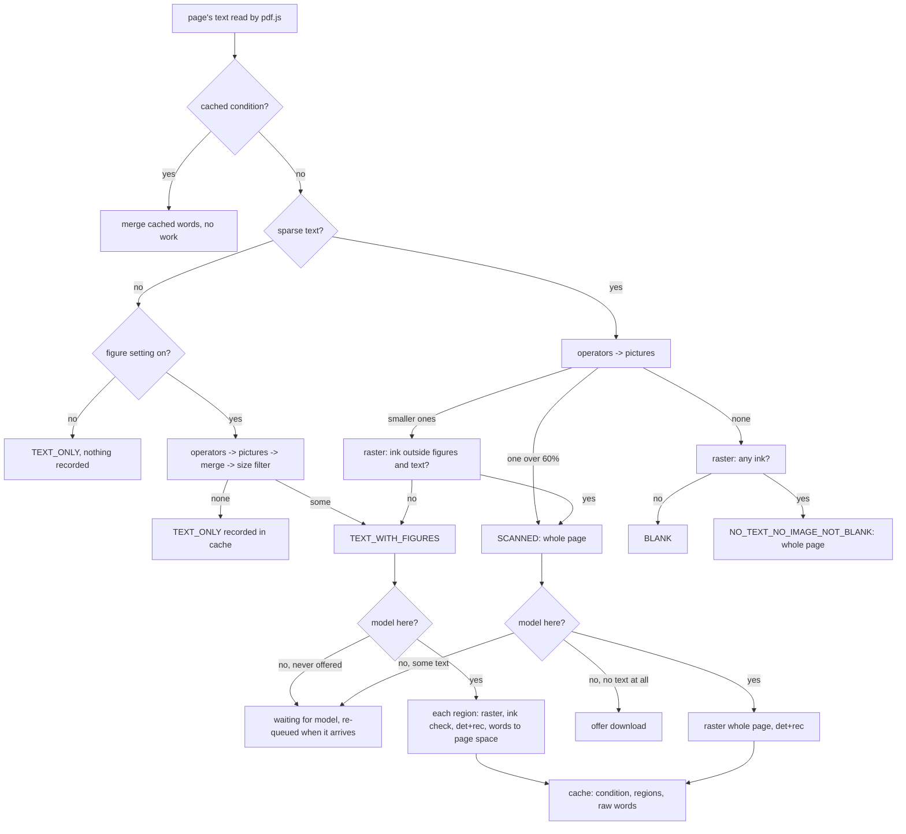

# On-device OCR for PDF pages

FineNotes reads text that exists only as pixels in a PDF, on the device, for
search, the highlighter that snaps to text, and Copy text. This document is for
contributors and for users who want to know exactly what it does.

## What it does, and what it does not

- Reads **scanned pages** (a picture of text), **pages with no text at all** that
  have ink (text drawn as outlines), and **the pictures on pages that have text
  of their own** (the labels in an anatomy figure, a chart, a photographed
  form). The last is "image-area OCR".
- Never reads text that is already in the page's text layer. Native text always
  wins: an OCR word that lies over it is dropped.
- **On demand, never the whole vault.** Only PDFs that an open notebook shows
  are looked at: the page in view first, then its neighbours, then the rest of
  that PDF only while idle. A PDF no open notebook uses is dropped from the
  queue. One page (one picture area) at a time; nothing starts while the pen
  writes.
- Nothing downloads without a yes. The model (23.7 MB for Fast, the default; see
  "Choosing a model" for the other two) is offered only for a page with no text of its own and some ink.
- Printed text only. Messy handwriting is left alone (see the filter below).
- Does not: read vertical or rotated text (lines leaning more than about 15
  degrees are dropped), read CJK reliably (the dictionary has 6,174 Chinese characters
  and no Japanese kana, and it is untested), tell double letters reliably, or read pages in the background of
  PDFs nobody has open. No run on a real iPad yet (see Known limits).

There is one switch, **Scanned pages** at the bottom of the AI menu in a notebook that has PDF pages
(`ocrScannedPdfs`, default on). It covers scanned pages and the text inside figures together. Turned off, nothing
is read and figure words already in the cache are hidden from layout and search at read time, not deleted;
turned on, the pages shown are looked at now. Pages already read are never read again by switching it off and
on, by closing and reopening a notebook, or by a restart: they come from the cache (`tests/view/ocr-service.test.ts`,
"reads a page once"). Only the command **Re-read scanned pages of this PDF**, or choosing a different reader,
reads them again.

Until the reader is on the device the AI menu's row is its download, marked with the download symbol. The first
page with no text of its own, and a tap on that row, open a question (`view/ocr-offer.ts`) that lists the readers
with their size and what each costs, Fast ticked and marked as recommended; Download starts the one ticked, and
Not now from the automatic question turns the switch off until the AI menu turns it on. The chosen reader is
`ocrModel` (`fast` by default, `accurate`, `most-accurate`); the row **Scanned pages · <choice>** in **Models on
this device** shows its download and is where it is removed (asked again, with the choice, at the next scanned
page). While pages are read a ring turns beside the page counter (`view/ocr-status.ts`). See "Choosing a model".

## Page conditions

Every page of a PDF that is looked at is exactly one of five conditions
(`src/recognition/ocr/figures.ts`, pure and unit-tested):

| condition                    | what the page is                                                                                | what is read                     |
| ---------------------------- | ----------------------------------------------------------------------------------------------- | -------------------------------- |
| `TEXT_ONLY`                  | text of its own, no picture worth reading                                                       | nothing: no raster, no model     |
| `TEXT_WITH_FIGURES`          | text of its own and at least one qualifying picture                                             | only the pictures' areas, padded |
| `SCANNED`                    | no or sparse text, one picture over at least 60% of the page (or other ink beside the pictures) | the whole page                   |
| `NO_TEXT_NO_IMAGE_NOT_BLANK` | no text, no qualifying picture, but ink                                                         | the whole page                   |
| `BLANK`                      | nothing on it                                                                                   | nothing                          |

How each is detected:

1. **Text.** The page's text items are laid out (`canvas/pdf-text.ts`). The page is
   _sparse_ when it has fewer than 40 characters or its characters cover less
   than 2% of its area (`isSparse`).
2. **Pictures, from the PDF itself.** pdf.js's operator list (`getOperatorList`,
   `OPS` from the same pdf.js `pdf-text-source.ts` uses) is turned into a short
   list of `save` / `restore` / `transform` / `image` operations (`gfxOpsFrom`;
   form XObjects become save + transform, repeated and grouped images one image
   per placement). `collectImages` follows the current transformation matrix,
   maps the unit square of every `paintImageXObject`, `paintInlineImageXObject`,
   `paintImageXObjectRepeat` and `paintImageMaskXObject` through it and the
   page's viewport (so rotation and an offset origin are right), boxes it
   (rotated and flipped images included), and clips it to the page. Its
   resolution is the stored pixels over the inches it covers. `mergeImages` joins
   boxes that overlap or lie within 3 pt (a picture cut into strips is one);
   `isFigureSized` drops those under 0.5 in on either side or under 1.5% of the
   page. The pdf.js call is a dozen lines (`view/pdf-figures.ts`).
3. **The decision** (`classifyPage`): text and no figure is `TEXT_ONLY`; text and a
   figure is `TEXT_WITH_FIGURES`; sparse with a figure covering at least 60% is
   `SCANNED`; sparse with smaller figures is `TEXT_WITH_FIGURES` _after_ a raster
   of the rest of the page shows no ink outside the figures and the page's own
   text (otherwise the whole page is read as `SCANNED`); sparse with no figure
   is `NO_TEXT_NO_IMAGE_NOT_BLANK` until a raster shows it has no ink at all,
   which makes it `BLANK` (`settledCondition`). When the pictures cannot be
   looked at (the figure setting is off, or the operator list failed) a dense
   page is left alone and a sparse one is read whole, as before, and nothing is
   recorded for it.

Clip paths other than the page edge are not tracked: a picture cropped by a clip
is taken whole, and the clipped part draws white, so it reads as nothing.

## The pipeline

(`src/recognition/ocr/`, pure; the networks are behind an `OcrBackend`.)

1. **Detection** (`det.ts`, `db.ts`). The image is cut into 800 px tiles with 96 px
   overlap, each run through PP-OCRv5 mobile **DBNet** (the v5 detector was kept; see "Model choice"); the probability maps are
   stitched. DB post-processing thresholds at 0.3, finds 8-connected blobs, fits a
   rectangle along each blob's own direction, scores it (mean probability at least
   0.6), grows it by the unclip distance (area x 1.5 / perimeter), and drops blobs
   that are tiny, unsure, or lean more than 0.26 rad. Boxes go into reading order.
2. **Recognition** (`rec.ts`, `ctc-words.ts`). Each box is cropped to 48 px high
   (`REC_CORE` 1.2: the box is taken to be 1.2x the text's height, so the crop is
   its height/1.2 and the font is not squashed), batched by width (4 per batch,
   widths within 1.35x), and run through the PP-OCRv6 tiny **SVTR** recogniser. **CTC** decoding
   gives characters with their positions and probabilities.
3. **Words** (`ctc-words.ts`, `word-edges.ts`). Characters are grouped into words at
   gaps; each word's box is extended by half the line's median character pitch
   beyond its first and last character (a tenth more on the right), then
   **snapped to the ink** of the crop: the widest ink-free gap between words. Mean
   word IoU against ground truth 0.82 to 0.89 on the noisy synthetic page.
   3b. **Second reading** (`REC_RETRY`). A line that has a word under the confidence filter, or no word, is
   read again with the box taken as 1.0 and as 1.4 times the text's height; the reading with the most
   trusted characters is kept.
4. Each word keeps its mean confidence and its least character confidence, and a
   line its mean. Words are boxed in the page's points (pixels / scale + the
   region's origin for a picture area).

### The handwriting confidence filter

Words are stored raw and filtered when read, so retuning needs no new reading
(`keptLines`, `OCR_TUNING`): a line is dropped whole when its mean confidence is
below **0.90**; a word is kept when the mean of its characters is at least
**0.90** and the least is at least **0.5**. On the synthetic page with scribbles
and cursive (7 regions) no scribble produced a kept word; the CER of what was kept
against the printed text was 0.14%. (Calibrated for the PP-OCRv6 tiny recogniser, see
"Model choice"; with the PP-OCRv5 multilingual recogniser it was 0.85 / 0.5 / 0.75.)

## Mixed pages and the native-text merge

`mergedItems` returns the page's own items plus the kept OCR words that do not lie
over native text (`dropCovered`): an OCR word is dropped when 30% of it lies under
one native word, or under several together (a label read as one word across a line
of text), or when IoU with one native word reaches 30%. A page with sparse text
gets OCR words only while it is still sparse; a `TEXT_WITH_FIGURES` page always
gets its figure words (unless the figure setting is off); `TEXT_ONLY` and `BLANK`
pages never do. Figure captions sit beside the pictures, which is why the overlap
drop is applied to figure words too.

## Image-area OCR

For a `TEXT_WITH_FIGURES` page the service reads each padded region on its own,
one at a time:

- **Padding.** Each figure box is widened by 6 pt (labels sit at the edge of a
  picture), kept on the page, and boxes that now touch are merged again so nothing is
  read twice.
- **Resolution** (`regionRaster`): about the picture's own stored pixel density,
  between 170 and 300 dpi, and with no side longer than 2200 px. Small figure labels
  (3 to 6 pt) need it.
- **Raster.** The shared PDF worker draws the page at that scale with a transform
  that moves the region's corner to the canvas corner; if the worker cannot run, the
  main-thread pdf.js does the same (`view/ocr-raster.ts`).
- **Ink check.** A region with no ink beyond the page's own text is not sent to the
  model.
- **Read.** det + rec on the region; the worker is told the region's origin so the
  words come back in page space. Same queue, priority, pen hold, cancel and retry
  rules as a whole page; if the pen goes down or the PDF is closed between two
  regions, the page is put back and read again later.
- **Download rule.** A `TEXT_WITH_FIGURES` page is read only when the model is
  already on the device. If it is not, the page waits in the "waiting for model"
  list and joins the queue when the model arrives. It never makes the download be
  offered (only a page with no text at all may).

## Tunables

`OCR_TUNING` (`ocr-words.ts`) and the other constants. "Measured" refers to the
lecture documents below or the synthetic page.

| name                                                                           | value                   | meaning, and why                                                                                                                                                                                                                                                                               |
| ------------------------------------------------------------------------------ | ----------------------- | ---------------------------------------------------------------------------------------------------------------------------------------------------------------------------------------------------------------------------------------------------------------------------------------------- |
| `wordMean`                                                                     | 0.90                    | a word's mean character confidence at least this (was 0.85 for the v5 recogniser). **Fast's value**: Accurate and Most accurate have their own, see "Choosing a model": scribbles reach 0.881 at most, printed text 0.984 at least; the scribble test kept none and the printed page lost none |
| `wordMin`                                                                      | 0.5                     | the least character at least this                                                                                                                                                                                                                                                              |
| `lineMean`                                                                     | 0.90                    | a line below this is dropped whole (was 0.75): scribble lines reach 0.881 at most, printed lines 0.997 at least                                                                                                                                                                                |
| `sparseAreaShare`                                                              | 0.02                    | native text covering under 2% of the page is sparse                                                                                                                                                                                                                                            |
| `sparseChars`                                                                  | 40                      | fewer characters is sparse (a page number, a header)                                                                                                                                                                                                                                           |
| `overlap`                                                                      | 0.3                     | share of an OCR word under native text that drops it                                                                                                                                                                                                                                           |
| `figureMinSide`                                                                | 36 pt                   | a picture under 0.5 in on either side is an icon, logo, bullet or badge; the smallest figure with labels in the lecture PDFs is 116 pt                                                                                                                                                         |
| `figureMinAreaShare`                                                           | 0.015                   | under 1.5% of the page is not a figure either                                                                                                                                                                                                                                                  |
| `figureMergeGap`                                                               | 3 pt                    | pictures this close are one figure (strips)                                                                                                                                                                                                                                                    |
| `figurePad`                                                                    | 6 pt                    | a label at the picture's edge is still read                                                                                                                                                                                                                                                    |
| `scannedShare`                                                                 | 0.6                     | a sparse page with a picture over 60% of it is a scan                                                                                                                                                                                                                                          |
| `figureMinDpi` / `figureMaxDpi`                                                | 170 / 300               | raster resolution follows the picture, clamped; every figure in the lecture PDFs is stored above 300 dpi, so all were read at 300 dpi                                                                                                                                                          |
| `figureMaxEdge`                                                                | 2200 px                 | longest side of a region raster (memory on a phone)                                                                                                                                                                                                                                            |
| `OCR_DPI` / `OCR_MAX_EDGE`                                                     | 170 / 2200              | whole-page raster                                                                                                                                                                                                                                                                              |
| `DET_TILE_SIDE` / `DET_TILE_OVERLAP`                                           | 800 / 96 px             | smaller tiles than 1280 cut peak memory by about 270 MB with the same accuracy                                                                                                                                                                                                                 |
| `DB_THRESHOLD`, `DB_BOX_SCORE`, `DB_UNCLIP_RATIO`, `MAX_TILT`                  | 0.3, 0.6, 1.5, 0.26 rad | PaddleOCR's own post-processing values; tilt is about 15 degrees                                                                                                                                                                                                                               |
| `MIN_PIXELS`, `MIN_SIDE`, `MIN_GROWN_SIDE`, `MIN_ELONGATION`                   | 12 px, 3 px, 6 px, 2    | box finder: a blob under 12 pixels, under 3 px thick, or under 6 px thick after growing is noise; a blob less than 2x longer than thick has no direction of its own                                                                                                                            |
| `MASK_PAD`                                                                     | 2 px                    | native text rectangles are widened by this when masked out of an ink or edge check                                                                                                                                                                                                             |
| `MAX_IMAGES`                                                                   | 1000                    | images read from one page's operators; more is a pattern, not a figure                                                                                                                                                                                                                         |
| `REC_CORE`                                                                     | 1.2                     | see the variant table                                                                                                                                                                                                                                                                          |
| `REC_STRIDE`, `REC_BATCH`                                                      | 8, 4                    | pixels per CTC time step; recogniser batches of 4 for memory                                                                                                                                                                                                                                   |
| `REC_RETRY`                                                                    | 1.0, 1.4                | the `REC_CORE` values a line the reader was unsure of is read again with; see the table of what was tried                                                                                                                                                                                      |
| `INK_LEVEL`, `BLANK_SHARE`                                                     | 225, 0.0002             | a pixel darker than 225 is ink; under 0.02% ink a page is blank                                                                                                                                                                                                                                |
| `EDGE_STEP`, `EDGE_SHARE`                                                      | 40 levels, 0.0004       | an edge is a luminance step of 40 between neighbours; 0.04% of the area as edges is content (a backdrop has none)                                                                                                                                                                              |
| ink / edge check copy                                                          | 256 / 640 px            | the longest side of the copy the ink check, and the edge check (which needs small print to survive), look at                                                                                                                                                                                   |
| `IDLE_RELEASE_MS`                                                              | 2 min                   | the OCR worker, and its models, are let go after this idle                                                                                                                                                                                                                                     |
| `correctMinLetters`, `correctMaxEdit`, `correctMaxEditLong`, `correctLongFrom` | 5, 1, 2, 9              | a misread word of 5 letters or more is corrected within one weighted edit (two from 9 letters); shorter words have too many neighbours                                                                                                                                                         |
| `correctConfusion`, `correctDoubled`                                           | 0.4, 0.5                | cost of a classic confusion (rn/m, cl/d, vv/w, li/h, I/l/1, O/0) and of a doubled or missing double letter, against 1 for any other edit                                                                                                                                                       |
| enclosed-symbol width                                                          | 1.6 letters             | how wide a symbol is taken to be when a word was stored without character positions                                                                                                                                                                                                            |
| `RIGHT_BIAS`                                                                   | 0.1                     | a tenth more on a word's right edge                                                                                                                                                                                                                                                            |
| `CLASSIFY_VERSION`                                                             | 1                       | bump when the classification rules change: a `TEXT_ONLY` page recorded under older rules is looked at again                                                                                                                                                                                    |
| `IDLE_MS`                                                                      | 3000                    | pages away from the one in view wait until nothing happened for this long                                                                                                                                                                                                                      |
| `RETRY_MS`, `MAX_FAILURES`                                                     | 60 s, 4                 | a failed page is not retried for a minute; four failures in a row and OCR rests for the session                                                                                                                                                                                                |
| `SAVE_MS`                                                                      | 2500                    | the cache is written this long after the last page                                                                                                                                                                                                                                             |

**REC_CORE variants** (synthetic scan pages, Chromium, real models; CER of all words
on `a-scan`, `a-scan-1col`; double-letter words exact): 1.0: 0.50%, 0.78%, 18/21;
1.1: 0.00%, 0.09%, 21/21; **1.2: 0.14%, 0.44%, 21/21 (chosen)**; 1.3: 0.36%, 0.17%. A horizontal stretch of 1.15 or 1.3 gave no gain (0.07% to 0.61%). 1.2 is
the value with all double letters right and no cost on the clean page.

## Model files

Downloaded on first use into `<plugin>/ocr/ppocrv6-1/`, never bundled, each pinned by
exact size and SHA-256 (`ocr-model.ts`), over https. All files are assets of the release `ocr-1` of
`Joost-8/FineNotes-templates` (the repository the voice models come from), with the Apache-2.0 licence text and a
notice; a release asset answers a byte range with the file's own bytes, uncompressed (not Git LFS, not Hugging Face,
not jsDelivr, which serves the wasm brotli-compressed even for `Accept-Encoding: identity`). Every request also
sends `Accept-Encoding: identity`:

| file                            | bytes      | SHA-256                | source, licence                                                                                      |
| ------------------------------- | ---------- | ---------------------- | ---------------------------------------------------------------------------------------------------- |
| `PP-OCRv5_mobile_det_infer.ort` | 4,896,928  | `30acfc4e...420abc`    | PaddleOCR PP-OCRv5 mobile detector, unchanged (npm `pdfmarkdown-ppocrv5-models@1.0.0`), Apache-2.0   |
| `PP-OCRv6_tiny_rec.ort`         | 4,530,048  | `efc46adf...a47767`    | PaddleOCR PP-OCRv6 tiny recogniser, unchanged from `ppu-paddle-ocr-models`, Apache-2.0               |
| `ppocrv6_tiny_dict.txt`         | 27,157     | `2f3717bb...eb21f2d`   | its dictionary: 6905 lines, line 0 the blank; PaddleOCR appends the space as the last (6906th) class |
| `ort-wasm-simd-threaded.wasm`   | 14,239,897 | `3398c10d...78842dee2` | onnxruntime-web 1.30.0, MIT                                                                          |

Total 23.7 MB (was 35.8 MB with the PP-OCRv5 multilingual recogniser). That is the **Fast** model. The other two
choices add one recogniser and one dictionary each, and share the detector and the wasm (see "Choosing a model"). The full hashes are in `src/recognition/ocr/ocr-model.ts` and
`THIRD_PARTY_NOTICES.txt` lists the licences. The OCR worker is started from a Blob
URL, one thread, handed the wasm bytes (no SharedArrayBuffer is needed).

## Model choice

The reader was PP-OCRv5 mobile detector + PP-OCRv5 mobile multilingual recogniser (18,385 classes, 35.8 MB
with the wasm). It is now **PP-OCRv5 mobile detector + PP-OCRv6 tiny recogniser** (6,905-line dictionary,
23.7 MB): about 2.2 times faster per page and at least as accurate on every measure the decision rule
looked at. This section is the measurement behind that, so the next change of model can be judged the same
way.

**Candidates** (PaddleOCR weights as converted by `ppu-paddle-ocr-models`, Apache-2.0, `.ort` format): detectors
v5 mobile (4.9 MB, the one kept), v6 tiny (1.9 MB), v6 small (10.0 MB); recognisers v5 multilingual (the old
one, 16.6 MB `.onnx`), v5 English fp32 (8.0 MB), v5 English int8 (7.1 MB), v6 tiny (4.5 MB), v6 small (21.3 MB).

**Conventions, checked against the real files** rather than assumed: every detector and recogniser takes the
same input as the v5 pair (detector: BGR, ImageNet mean and deviation, a `1 x 1 x H x W` probability map out;
recogniser: `n x 3 x 48 x W`, BGR, `(x/255 - 0.5)/0.5`, one time step per 8 px). Every recogniser's output
is a probability per class (each row sums to 1.0000, so no softmax is needed). Dictionaries differ: the v5
multilingual file listed every class (its last line was the space); the v6 and v5-English files have the
blank as line 0 and **no space line** (PaddleOCR appends it): the model has one class more than the file has
lines (v6 tiny 6,906 against 6,905; v6 small 18,710 against 18,709; v5 English 438 against 437). `alphabetFrom`
therefore adds the space as the last class, and the existing class-count check in `readPage` would have
refused a mismatch. Each runs under onnxruntime-web 1.30.0 with the plain (non-JSEP) wasm, one thread, in the
Blob worker; the worker's result is identical to the main thread's. Symbols that matter in medical notes
are in every new dictionary, including the 6,905-line v6 tiny one: the Greek delta and mu, the degree sign,
plus-minus, greater-or-equal, less-or-equal, alpha, beta, the multiplication sign, arrows, accented letters
and the curly quotes. The v5 English dictionary (437 lines) has them too, except the en dash; it has no
non-Latin script beyond that set, which is why an English-only model is not the default.

**The matrix** (det x rec). Synthetic pages: A4 at 170 dpi, CER of all words on the clean, noisy two-column
(`a-scan`) and one-column pages, mean word IoU on the noisy page, time on the noisy page. "scribbles" is how
many of the 7 scribble and cursive regions keep a word; 53.pdf is the 171-label ground truth with
normalisation and vocabulary correction. "Heap" is the wasm heap peak of the OCR worker for one page. Size is
the download with the 14.2 MB wasm. Accuracy columns for v5 multi are at its own calibration (0.85 / 0.5 / 0.75);
for the others at their defaults, and at the new calibration (0.90 / 0.5 / 0.90) after the slash.

| det      | rec               | CER clean / noisy / 1-col | IoU noisy | scribbles kept       | 53.pdf recall                | 53.pdf precision | det / rec ms    | heap MB | size MB  | 53.pdf OCR+raster s | verdict                                                                                       |
| -------- | ----------------- | ------------------------- | --------- | -------------------- | ---------------------------- | ---------------- | --------------- | ------- | -------- | ------------------- | --------------------------------------------------------------------------------------------- |
| v5       | v5 multi (before) | 0.00 / 0.14 / 0.44        | 0.883     | 0 / 7                | 145 = 84.8%                  | 97.6%            | 3278 / 8352     | 193     | 35.8     | 37.5                | baseline                                                                                      |
| v5       | v5 EN fp32        | 0.00 / 0.00 / 0.00        | 0.883     | 2 / 7, 0 / 7         | 147 = 86.0%, 146 = 85.4%     | 97.7%, 98.4%     | 3122 / 7098     | 106     | 27.1     | 28.3                | passes after recalibration, but slower than v6 tiny and English only; not chosen              |
| v5       | v5 EN int8        | 0.00 / 0.00 / 0.00        | 0.883     | 2 / 7, 0 / 7         | 146 = 85.4%, 147 = 86.0%     | 97.5%, 98.6%     | 3210 / 7094     | 122     | 26.3     | 32.6                | as fp32; recognition 7.1 s, no faster than fp32; not chosen                                   |
| **v5**   | **v6 tiny**       | **0.00 / 0.00 / 0.00**    | **0.883** | 3 / 7, **0 / 7**     | 148 = 86.5%, **147 = 86.0%** | 95.7%, **96.3%** | **3218 / 2359** | **120** | **23.7** | **16.7**            | **adopted**                                                                                   |
| v5       | v6 small          | 0.00 / 0.00 / 0.00        | 0.883     | 2 / 7 (also at 0.90) | 154 = 90.1% (at 0.90)        | 96.4% (at 0.90)  | 3142 / 11835    | 181     | 40.5     | 37.5                | pruned: rec 40% slower than the old one (page 15 s against 12 s); scribbles not 0 / 7 at 0.90 |
| v6 tiny  | v6 tiny           | 0.00 / 0.00 / 0.00        | 0.858     | 1 / 7, 0 / 7         | 153 = 89.5%, 154 = 90.1%     | 96.8%, 98.4%     | 1810 / 2144     | 75      | 20.7     | 12.6                | pruned: noisy IoU 0.858 < 0.88 (clean page 0.856)                                             |
| v6 small | v6 small          | 0.00 / 0.00 / 0.00        | 0.843     | 2 / 7 (also at 0.90) | 160 = 93.6% (at 0.90)        | 99.3% (at 0.90)  | 4484 / 9564     | 184     | 45.6     | 39.3                | pruned: slower than the old one, IoU 0.843                                                    |

Not run (8 of the 15 pairs): v6 tiny or v6 small detector with v5 multi, v5 EN, v5 EN int8 and the other v6
recogniser. Why: the detector alone decides the word boxes, and both v6 detectors fail the IoU floor (0.858,
0.843) while the four recognisers on the v5 detector give the same IoU to three decimals (0.883), so
the rec does not rescue it; and v6 small as a recogniser is slower than the baseline. The v6 tiny detector
is the one that came closest: 1.4 s faster per page than v5's, and the best label recall of the tiny models
(89.5% to 90.1%), but its boxes reach on average 1.0 px below the ground-truth text box (v5: 0.6 px) and 43
of 221 words of the noisy page fall under IoU 0.75 (12 for v5). Unclip ratios 1.3, 1.7, 2.0 and thresholds
0.2 and 0.4 gave 0.863 at best; a decision on the v6 tiny detector would need its own post-processing
calibration. That is the most promising next step: it would take the page to about 4 s.

**Scripts: what the smaller dictionary gives up.** Counted in the dictionaries (single characters). v5 multi:
15,565 Chinese, 180 kana, 76 Greek, 83 accented Latin, 11 Cyrillic, 2 Hangul. v6 tiny: 6,174 Chinese (the
common set), **no kana**, 50 Greek (the capitals and the common small letters, delta and mu included), 193
accented Latin, no Cyrillic, no Hangul. So accented European text and Greek are covered at least as well
as before; Japanese and rare Chinese characters are not read any more. CJK was documented as untested and the
test pages and lecture PDFs are English; the loss is real and is the price of the speed. v6 small
(`ppocrv6_dict.txt`, 18,709 lines, 400 accented Latin, the same 15,565 Chinese and 180 kana) would keep
them, at a page time of 15 s.

**Decision rule** (faster in total page time **and** no worse on every accuracy metric: synthetic CER per
page within 0.1 point, noisy IoU at least 0.88, scribbles 0 / 7, 53.pdf recall at least 84.8% and precision
at least 95%). v5 detector + v6 tiny recogniser passes: page time 5.5 s against 12.1 s, CER 0.00% on all three pages
(0.14% and 0.44% before), IoU 0.883, scribbles 0 / 7, recall 86.0% and precision 96.3%, a 34% smaller download, and a
dictionary that is not English-only (Latin with accents, Greek, symbols, 6,174 Chinese characters; see below), so
the English-only recognisers, which also pass after the same recalibration, were not needed; no opt-in
setting was added for them. 53.pdf
(17 figure regions, 491 words): 16.7 s of OCR and raster against 37.5 s. 57.pdf still costs 0 OCR calls and 0 rasters.

**Recalibration of the confidence filter.** The thresholds had been set for the v5 multilingual recogniser,
which reads printed text with mean confidences from 0.915 and lines from 0.937. The new recognisers are far
more confident on printed text and also more confident on scribbles; at the old thresholds 3 of the 7 scribble
regions of the test page kept a word. The distributions (the test pages, 835 to 844 printed words, 110
printed lines; the 7 scribble and cursive regions):

| recogniser | printed words: least mean / least character | printed lines: least | scribble words: most mean / most of the least character | scribble lines: most |
| ---------- | ------------------------------------------- | -------------------- | ------------------------------------------------------- | -------------------- |
| v5 multi   | 0.915 / 0.713                               | 0.937                | 0.591 / 0.415                                           | 0.591                |
| v5 EN      | 0.997 / 0.983                               | 0.999                | 0.888 / 0.752                                           | 0.888                |
| v6 tiny    | 0.984 / 0.922                               | 0.997                | 0.881 / 0.761                                           | 0.881                |

The method is the old one: put the thresholds between the highest scribble value and the lowest printed value,
then check that real figure labels are not lost. The word and line means move from 0.85 and 0.75 to **0.90 and
0.90** (above the 0.881 of the most confident scribble, "mwmm" read from a scribble; below the 0.984 of
printed text); the character minimum stays 0.5. Measured on 53.pdf with v6 tiny, the settings tried, each
with the scribble test: 0.85 / 0.75 (old): scribbles 3 / 7, recall 148 = 86.5%, precision 95.7%;
**0.90 / 0.90: 0 / 7, 147 = 86.0%, 96.3%**; 0.93 / 0.93: 0 / 7, 146 = 85.4%, 96.8%; word 0.90 only: 0 / 7, 147,
96.3%; line 0.90 only: 0 / 7, 148, 96.1%; word 0.92, line 0.90, character 0.6: 0 / 7, 147, 96.6%. Raising
the line mean alone would have been enough on this page; both were raised so a lone scribbled word has the same
margin as a line. `REC_CORE` 1.2 and `REC_RETRY` were not recalibrated: the double letters are right on every
page (21 / 21 and 17 / 17) and the recogniser has no weakness there that a different crop would fix.
`DB_*` and the box finder are the v5 detector's, unchanged.

**What changed in the product.** `ocr-model.ts`: new files, sizes and hashes, folder `ocr/ppocrv6-1`, model id
`ocr-ppocrv6`, version "2" (an old install has nothing in the new folder and is offered the download again;
the old `ocr/ppocrv5` folder is not deleted), and `OCR_MODEL_VERSION` `ppocrv6-tiny-1` (every cached page read
by `ppocrv5-mobile-1` is read again). `alphabetFrom` appends the space. `OCR_TUNING.wordMean` 0.85 to 0.90 and
`lineMean` 0.75 to 0.90. Nothing else.

**Hosting.** Every file is an asset of the release `ocr-1` of `Joost-8/FineNotes-templates`, with `LICENSE` (the
Apache-2.0 text) and `NOTICE.txt`. Checked after the upload: each file's SHA-256 matches the pin, and
`Range: bytes=0-99` answers 206 with 100 bytes, a `Content-Range` total equal to the file's size, and no
`Content-Encoding`.

## Choosing a model

The question about which reader to download (see the top of this document) has three choices. All three use the PP-OCRv5 mobile detector (the v6 detectors failed the IoU floor,
see "Model choice") and differ in the recogniser.

| choice                      | recogniser               | download (with detector and wasm) | wasm heap after load / peak (one page) | det + rec, dense A4 page | 53.pdf labels exact | 53.pdf precision | marks kept (96) | where                   |
| --------------------------- | ------------------------ | --------------------------------- | -------------------------------------- | ------------------------ | ------------------- | ---------------- | --------------- | ----------------------- |
| **Fast** (default)          | PP-OCRv6 tiny, 4.5 MB    | 23.7 MB                           | 33 / 120 MB                            | 3.3 + 2.4 = 5.7 s        | 146 = 85.4%         | 97.2%            | 0 / 96          | every device            |
| **Accurate**                | PP-OCRv6 small, 21.3 MB  | 40.5 MB                           | 87 / 181 MB                            | 3.4 + 10.4 = 13.8 s      | 151 = 88.3%         | 97.0%            | 0 / 96          | every device            |
| **Most accurate** (desktop) | PP-OCRv6 medium, 76.7 MB | 95.9 MB                           | 196 / 236 MB                           | 3.2 + 44.3 = 47.5 s      | 149 = 87.1%         | 97.3%            | 0 / 96          | desktop only, off vault |

Measured in the same harness as "Model choice" (Chromium, one wasm thread, the OCR worker, a 4-core Linux
sandbox; the synthetic A4 page at 170 dpi; 53.pdf is the 171-label ground truth, 17 figure regions, 491 words).
The size column is what the setting shows beside each choice ("Fast (23.7 MB)"); the speed column is the
measurement behind "slower" in the setting's ⓘ. A real laptop will differ, and an iPad is not measured. 53.pdf OCR and raster time: Fast 16.9 s, Accurate 36.7 s,
Most accurate 129.9 s. On every synthetic page (clean, noisy two-column, one column, merge page) all three read
every word exactly after the confidence filter (kept CER 0.00%, double letters 21/21 and 17/17, mean IoU
0.883 on the noisy page: the detector is the same). The labels exact are at each choice's final thresholds
below; at the Fast thresholds Accurate would read 154 (90.1%) and Most accurate 153 (89.5%), but would keep
marks and garbled words (see "Handwriting test set").

**Rules.**

- Fast is the default and what every existing install uses: same model id (`ocr-ppocrv6`), version, folder and
  cache version, no download, no behaviour change.
- Accurate is offered on every platform. On a phone or tablet its row says "Accurate is about 2x slower per page
  than Fast (desktop measurement)" (13.8 s against 5.7 s on the laptop; the iPad is not measured).
- Most accurate is offered on desktop only (`Platform.isMobile` hides it; a vault whose settings chose it
  and that is opened on a phone uses Fast). Its asset is `deviceOnly`, as the large Whisper model is: it lives in
  IndexedDB on that computer, outside the vault, so its 76.7 MB never syncs to a phone.
- The detector and the wasm are one pair of files in `ocr/ppocrv6-1` for all three (`ModelAsset.shared`), found
  there by every choice: switching never downloads them again, not even for Most accurate (whose own files
  are outside the vault). A choice's own download is its recogniser and dictionary only, when the detector and wasm
  are already on the device: Accurate 21.4 MB, Most accurate 76.8 MB.
- Small and medium share one dictionary, `ppocrv6_dict.txt` (18,709 lines, 400 accented Latin letters, 180 kana,
  so Japanese is read again with them); tiny has its own 6,905-line one (no kana).

**Switching** (`OcrService.modelChanged`): the new choice's download is offered through the usual card if it is
not on the device; the other choices' files are kept (nothing is deleted on a switch); the worker lets the old
model go and loads the new one when the next page is read (no restart of Obsidian); and each choice has its own
cache version (`ppocrv6-tiny-1`, `ppocrv6-small-1`, `ppocrv6-medium-1`), so pages another choice read count as
not read and are read again with the chosen one as the notebooks ask for them. A page read while the setting changes is
dropped, not recorded under the wrong version. The cache holds one entry per page, so switching back re-reads
the pages once more.

**What a page shows after a switch.** Until a page's reading with the chosen model is stored, the page keeps
showing what the previous model read of it (`OcrService.cachedStale`, `staleCachedPage`): search, the
text-snapping highlighter and Copy text work on it as before, so a switch never blanks a notebook. The old
words are filtered with the thresholds of the model that read them (each cache entry records its model version,
and `OcrService.tuning(version)` gives that tier's confidence), never with the chosen model's. The page is queued
for the chosen model in the usual order; when its reading is stored it replaces the old one and the notebook is
told (`ocrReady`). If the user never downloads the new model, the pages stay queued (the download card is
offered as before) and the old words stay. Only pages with words are kept this way: a `TEXT_ONLY` or `BLANK`
entry holds none, and an entry of a version this build does not know cannot be judged, so neither is shown.
Tests: `tests/view/ocr-service.test.ts` ("the choice of model"), `tests/view/pdf-text-ocr.test.ts` and
`tests/recognition/ocr/cache-queue.test.ts`.

**Remove other OCR models** (`view/ocr-models.ts`; the trash button on the row **Scanned pages · <choice>** in Models
on this device) removes the choices not in use and the
obsolete folder `ocr/ppocrv5`; only it deletes anything, and the detector and wasm stay. A download in
flight is left running. `tests/view/ocr-models-integration.test.ts` runs it against the real `ModelRegistry` stores
over a fake vault adapter holding the real file names in the real folders: with Accurate in use, Fast's own
files (tiny recogniser and dictionary) go and the shared detector and wasm in `ocr/ppocrv6-1` and Accurate's
files stay; with Fast in use, the small and medium own files go and the shared ones are untouched; `ocr/ppocrv5`
goes; every change the cleanup makes is inside `ocr/`; a download in flight is untouched and finishes. It also
pins that no tier names other versions of its main file (`prefix` / `suffix` unset), so `storedVersions` for one
tier can never take another tier's files, or the shared ones, for another version of itself.

**Thresholds per recogniser.** A larger recogniser is more confident about everything, scribbles included, so
the thresholds of the tiny one (then 0.90 / 0.90 / 0.5) are not safe for the others: at them both keep two of the seven
scribble regions (the cursive word "important", which they read correctly: 0.908 small, 0.960 medium). Calibration is
the method of "Model choice": put the threshold between the most confident scribble and the least confident
printed text, then check figure labels. Distributions (synthetic pages: 844 printed words, 110 printed lines;
the 7 scribble and cursive regions; before the filter):

| recogniser | printed words: least mean / least character | printed lines: least | scribble words: most mean / most of the least character | scribble lines: most |
| ---------- | ------------------------------------------- | -------------------- | ------------------------------------------------------- | -------------------- |
| tiny       | 0.984 / 0.922                               | 0.997                | 0.881 / 0.761                                           | 0.881                |
| small      | 0.996 / 0.996                               | 1.000                | 0.908 / 0.751                                           | 0.908                |
| medium     | 0.999 / 0.991                               | 1.000                | 0.960 / 0.810                                           | 0.960                |

(Scribble words of the small and medium models differ slightly from run to run, because a line the filter
distrusts is read again and the reading that survives depends on the threshold; the figures are from the
runs at the default thresholds.)

Threshold sweep, each a real run (scribble test page, then 53.pdf). `wordMean` is also `lineMean`; "labels
exact" and precision as in "Model choice"; the chosen row is bold.

| recogniser | wordMean = lineMean / wordMin | scribbles kept | 53.pdf labels exact | 53.pdf precision |
| ---------- | ----------------------------- | -------------- | ------------------- | ---------------- |
| small      | 0.90 / 0.5 (Fast's)           | 2 / 7          | 154 = 90.1%         | 96.4%            |
| small      | 0.93 / 0.5                    | 0 / 7          | 151 = 88.3%         | 96.6%            |
| small      | **0.95 / 0.5**                | **0 / 7**      | **151 = 88.3%**     | **97.0%**        |
| small      | 0.90 / 0.8                    | 0 / 7          | 148 = 86.5%         | 95.7%            |
| small      | 0.95 / 0.8                    | 0 / 7          | 147 = 86.0%         | 97.0%            |
| medium     | 0.90 / 0.5 (Fast's)           | 2 / 7          | 153 = 89.5%         | 95.6%            |
| medium     | 0.90 / 0.9                    | 2 / 7          | 151 = 88.3%         | 95.6%            |
| medium     | 0.97 / 0.5                    | 0 / 7          | 150 = 87.7%         | 96.8%            |
| medium     | 0.98 / 0.5                    | 0 / 7          | 148 = 86.5%         | 97.5%            |
| medium     | **0.95 / 0.9**                | **0 / 7**      | **151 = 88.3%**     | **96.6%**        |

Chosen first on the 7-region test page and 53.pdf (above), then **re-checked and changed on the 126-region
handwriting test set** (next section, "Handwriting test set"). Now (`OCR_TIERS` in `ocr-model.ts`; one
`OcrConfidence` per recogniser, handed to the worker so the lines it reads again are the ones that choice
distrusts, and to the text layer so a page is filtered with the thresholds of the model that read it):
**Fast 0.90 / 0.95 / 0.5**; **Accurate 0.95 / 0.95 / 0.5** (midway between the most confident garbage, 0.916, and
the least confident printed word, 0.980); **Most accurate 0.95 / 0.98 / 0.9**. The first calibration's reasoning
for the medium model (a mean of 0.98 would pass its most confident scribble, 0.960, at three labels' cost; the
least character is a second signal) stood on one cursive word; on the larger set the line mean is what separates
its marks from print, and `wordMin` 0.9 is kept for the multi-character garbage it still removes. On the synthetic pages the final thresholds
lose no printed word (kept CER 0.00%) and on the handwriting set no tier keeps a mark or garbled word.

No extra signal was needed: neither the per-character margin (top-1 minus top-2 probability), tried on the larger
set, nor an agreement test between the `REC_CORE` and `REC_RETRY` readings was added (see "Handwriting test set"
for the margin's numbers).

**Is the medium model usable? Yes on a desktop, slowly.** Loads under the single-thread wasm in 0.3 s of
`ensureModel` (plus reading 77 MB from IndexedDB), wasm heap 196 MB after load and 236 MB peak for a dense page (the
1 GB limit set for the decision is far off), 47.5 s per dense page (4.1 times the small model, 8.3 times Fast),
129.9 s for the 17 figure regions of 53.pdf. Its recall on 53.pdf is not above the small model's (151 and 151 at their
final thresholds; 153 against 154 at Fast's), so what the extra 55 MB and 34 s per page buy is not visible on these
test pages; the synthetic pages are read perfectly by all three. It is offered because the user asked for it, with
that measurement beside it.

## Handwriting test set

The first calibration used one test page with 7 scribble and cursive regions, and the medium model's threshold
was decided by one cursive word. It was replaced by a set of **126 handwriting regions on 6 printed pages**
(harness not committed; it draws the pages in a browser canvas and runs the committed `readPage` with the real
models, as "Model choice" does).

**Printed side.** 6 pages, A4 at 170 dpi, 2,431 words: Liberation Serif 11 pt (two columns), Liberation Sans 9 pt,
DejaVu Serif 12 pt, Carlito 14 pt, Caladea 10 pt (two columns), FreeSerif 8 pt (dense), each with its own rotation
(-1.0 to +1.2 degrees), noise (6 to 12) and blur (0.4 to 0.6 px). Every page is read twice, with and without the
handwriting, so printed recall and CER are measured on the clean render and the damage done by ink on the other.

**Handwriting side** (each region is one mark or word, drawn at 170 dpi with pen widths of 1.2 to 3.4 px, in
black, blue or red, scaled, mirrored and rotated, and degraded with the page like a scan):

| source                                                                         | regions | what                                                                                                                                                                                            |
| ------------------------------------------------------------------------------ | ------- | ----------------------------------------------------------------------------------------------------------------------------------------------------------------------------------------------- |
| real iPad / Pencil strokes from the repo's own fixtures (`tests/ink/fixtures`) | 72      | 15 scribbles (`real-scribbles-ipad`), 6 squiggles, 9 arrows, 36 shapes (triangles, hearts, stars, clouds, quads), 6 groups of three single-stroke characters ("6", "o") from UJI Pen Characters |
| handwriting typeface (NothingYouCouldDo) and a joined italic serif             | 24      | words and short notes ("exam", "see p. 12", "= 42", "good point", "why?"), each letter jittered in slant, rotation and baseline                                                                 |
| generated                                                                      | 30      | 6 random-walk scribbles, 6 arrows, 18 marks on printed words: cross-out lines and zigzags, circles, wavy underlines                                                                             |

Placement: 35 over the text, 23 in the right margin, 20 in the left, 14 above, 16 below, and 18 on a printed word
(61 regions touch printed text in all). **What the set does not have:** real handwritten _words_. The repository's
only handwriting fixtures that are words (`hwr-golden.json`) are synthetic, and no cursive font is installed beyond
the one used here, so the 24 written words are neater than most hands and the models read them. That is why the
results are split below.

**A region counts as kept** when a word the filter kept overlaps it and is not a printed word (a kept word belongs
to the region it overlaps most). Marks (96 regions: everything but written words) have no text, so any kept word
is a false keep. A written word or group of characters (30 regions) kept _as what it says_ is a legible reading,
not noise; a kept word that is not what was written is garbage. Both are reported, and the sum is the requested
"regions with any kept word".

Per tier, with the thresholds before and after (`final` is what ships; the "before" rows are the same raw readings filtered with the old numbers, re-read for the final rows):

| tier          | thresholds                               | handwriting false-keep (any kept word) | marks kept (no text)     | written words: garbage / legible only | printed recall, clean pages        | printed CER | printed recall with ink on the page | 53.pdf labels exact | 53.pdf precision |
| ------------- | ---------------------------------------- | -------------------------------------- | ------------------------ | ------------------------------------- | ---------------------------------- | ----------- | ----------------------------------- | ------------------- | ---------------- |
| Fast          | before: 0.9 / 0.9 / 0.5                  | 12 / 126 = 9.5% [5.5, 15.9]            | 1 / 96 = 1.0% [0.2, 5.7] | 1 / 30, 10 / 30                       | 2431 / 2431 = 100.0% [99.8, 100.0] | 0.00%       | 92.1%                               | 147 = 86.0%         | 96.3%            |
| Fast          | **final**: 0.9 / 0.95 / 0.5              | 6 / 126 = 4.8% [2.2, 10.0]             | 0 / 96 = 0.0% [0.0, 3.8] | 0 / 30, 6 / 30                        | 2431 / 2431 = 100.0% [99.8, 100.0] | 0.00%       | 89.6%                               | 146 = 85.4%         | 97.2%            |
| Accurate      | **final** (unchanged): 0.95 / 0.95 / 0.5 | 14 / 126 = 11.1% [6.7, 17.8]           | 0 / 96 = 0.0% [0.0, 3.8] | 0 / 30, 14 / 30                       | 2425 / 2431 = 99.8% [99.5, 99.9]   | 0.02%       | 94.1%                               | 151 = 88.3%         | 97.0%            |
| Most accurate | before: 0.95 / 0.95 / 0.9                | 16 / 126 = 12.7% [8.0, 19.6]           | 2 / 96 = 2.1% [0.6, 7.3] | 0 / 30, 14 / 30                       | 2431 / 2431 = 100.0% [99.8, 100.0] | 0.00%       | 93.7%                               | 151 = 88.3%         | 96.6%            |
| Most accurate | **final**: 0.95 / 0.98 / 0.9             | 13 / 126 = 10.3% [6.1, 16.9]           | 0 / 96 = 0.0% [0.0, 3.8] | 0 / 30, 13 / 30                       | 2431 / 2431 = 100.0% [99.8, 100.0] | 0.00%       | 92.6%                               | 149 = 87.1%         | 97.3%            |

Intervals are Wilson 95% intervals. Thresholds are `wordMean / lineMean / wordMin`. "Printed recall" is the share
of printed words read exactly and kept on the clean pages (the 6 words Accurate loses are two merged pairs
("from 61", "from Bruges,") that the detector put in one box, not a threshold). "With ink on the page" is the same
on the pages with handwriting, where words under a cross-out or scribble are lost or misread (40, 32 and about 17
printed words are kept _misread_ at Fast, Accurate and Most accurate: no threshold is aimed at them).
53.pdf rows: labels exact and precision as in "Model choice", re-run with each tier's thresholds.

**What the thresholds can and cannot do.** The numbers that decide are where the marks and garbled writing end and
where printed text begins, per tier (raw, before the filter):

| tier          | marks and garbled writing: most confident word / line     | printed words: least mean / least character / least line | gap used                                              |
| ------------- | --------------------------------------------------------- | -------------------------------------------------------- | ----------------------------------------------------- |
| Fast          | 0.919 / 0.919                                             | 0.922 / 0.682 / 0.989                                    | line mean 0.95 (words overlap: 0.919 against 0.922)   |
| Accurate      | 0.916 / 0.925 (one merged line with printed words: 0.985) | 0.980 / 0.901 / 0.999                                    | word and line mean 0.95 (midpoint of 0.916 and 0.980) |
| Most accurate | 0.977 / 0.977                                             | 0.996 / 0.990 / 0.998                                    | line mean 0.98 (0.977 against 0.998)                  |

Legible handwriting cannot be separated this way and the sweeps below show it: the models read it with the same
confidence as print (Accurate 0.999 median, Most accurate 0.999), so keeping all of it out would need a mean of
0.99 and costs printed words. It is not noise, it is text that is there.

**Threshold changes** (each from the sweeps below; only the line mean moved):

- **Fast 0.90 / 0.90 / 0.5 -> 0.90 / 0.95 / 0.5.** At the old line mean one real shape was kept as a kanji
  (0.919) and "good point" as "g00d Point"; the word mean cannot separate them (0.919 against the least printed
  word at 0.922, too close to place a threshold in), but printed _lines_ start at 0.989, so the line mean can move
  to 0.95 with room on both sides. Cost: one 53.pdf label (147 to 146, 86.0% to 85.4%, still above the 84.8% of
  the baseline the decision rule used), precision up 96.3% to 97.2%; no printed word lost on the clean pages.
- **Accurate 0.95 / 0.95 / 0.5, unchanged.** Marks 0 of 96 and garbage 0 of 30; 0.90 would keep one mark.
- **Most accurate 0.95 / 0.95 / 0.9 -> 0.95 / 0.98 / 0.9.** The old line mean kept a squiggle as "m" (0.977) and a
  drawn star as a star glyph (0.963). 0.98 keeps neither. Cost: two 53.pdf labels (151 to 149, 88.3% to 87.1%),
  precision up 96.6% to 97.3%. The margin over the squiggle is only 0.003 (one sample sets it); the least-character
  alternative (0.98) cost six labels (145) and was not taken. `wordMin` 0.9 stays: it is not what decides here (the squiggle "m" is one character at 0.977,
  printed words start at 0.990), but it removes multi-character garbage (0.613 at most) and 0.9 against 0.5 leaves
  the same marks and clean-page recall while keeping 7 fewer misread printed words under ink (17 against 24).

**Sweeps** (each row is the same readings filtered with different thresholds; "marks kept" counts the 96 regions with no text, "garbage" the written words kept as something else; the chosen row is bold; 53.pdf columns are real runs with those thresholds, or from the earlier round where the row existed there):

Fast (read at 0.90 / 0.90 / 0.5; the filter swept offline, the chosen row is also re-read below):

| wordMean / lineMean / wordMin | marks kept | written: garbage | any kept word, 95% interval  | printed recall, clean pages | printed recall, ink pages | 53.pdf labels exact | 53.pdf precision |
| ----------------------------- | ---------- | ---------------- | ---------------------------- | --------------------------- | ------------------------- | ------------------- | ---------------- |
| 0.90 / 0.90 / 0.5             | 1 / 96     | 1 / 30           | 12 / 126 (9.5%, 5.5 to 15.9) | 100.00%                     | 92.1%                     | 147 = 86.0%         | 96.3%            |
| 0.90 / 0.92 / 0.5             | 0 / 96     | 0 / 30           | 9 / 126 (7.1%, 3.8 to 13.0)  | 100.00%                     | 90.3%                     | 147 = 86.0%         | 96.8%            |
| **0.90 / 0.95 / 0.5**         | 0 / 96     | 0 / 30           | 4 / 126 (3.2%, 1.2 to 7.9)   | 100.00%                     | 88.9%                     | 146 = 85.4%         | 97.2%            |
| 0.90 / 0.97 / 0.5             | 0 / 96     | 0 / 30           | 2 / 126 (1.6%, 0.4 to 5.6)   | 100.00%                     | 87.6%                     | not run             | not run          |
| 0.92 / 0.90 / 0.5             | 0 / 96     | 0 / 30           | 9 / 126 (7.1%, 3.8 to 13.0)  | 100.00%                     | 91.9%                     | not run             | not run          |
| 0.92 / 0.95 / 0.5             | 0 / 96     | 0 / 30           | 4 / 126 (3.2%, 1.2 to 7.9)   | 100.00%                     | 88.7%                     | not run             | not run          |
| 0.95 / 0.95 / 0.5             | 0 / 96     | 0 / 30           | 4 / 126 (3.2%, 1.2 to 7.9)   | 99.92%                      | 88.6%                     | not run             | not run          |
| 0.99 / 0.99 / 0.5             | 0 / 96     | 0 / 30           | 1 / 126 (0.8%, 0.1 to 4.4)   | 99.05%                      | 80.4%                     | not run             | not run          |

Accurate (no change; read at the final thresholds):

| wordMean / lineMean / wordMin | marks kept | written: garbage | any kept word, 95% interval   | printed recall, clean pages | printed recall, ink pages | 53.pdf labels exact | 53.pdf precision |
| ----------------------------- | ---------- | ---------------- | ----------------------------- | --------------------------- | ------------------------- | ------------------- | ---------------- |
| 0.90 / 0.90 / 0.5             | 1 / 96     | 0 / 30           | 15 / 126 (11.9%, 7.3 to 18.7) | 99.75%                      | 94.8%                     | 154 = 90.1%         | 96.4%            |
| 0.92 / 0.92 / 0.5             | 0 / 96     | 0 / 30           | 14 / 126 (11.1%, 6.7 to 17.8) | 99.75%                      | 94.7%                     | not run             | not run          |
| 0.93 / 0.93 / 0.5             | 0 / 96     | 0 / 30           | 14 / 126 (11.1%, 6.7 to 17.8) | 99.75%                      | 94.4%                     | 151 = 88.3%         | 96.6%            |
| **0.95 / 0.95 / 0.5**         | 0 / 96     | 0 / 30           | 14 / 126 (11.1%, 6.7 to 17.8) | 99.75%                      | 94.1%                     | 151 = 88.3%         | 97.0%            |
| 0.97 / 0.97 / 0.5             | 0 / 96     | 0 / 30           | 13 / 126 (10.3%, 6.1 to 16.9) | 99.75%                      | 93.1%                     | not run             | not run          |
| 0.98 / 0.98 / 0.5             | 0 / 96     | 0 / 30           | 12 / 126 (9.5%, 5.5 to 15.9)  | 99.75%                      | 92.6%                     | not run             | not run          |
| 0.95 / 0.95 / 0.9             | 0 / 96     | 0 / 30           | 13 / 126 (10.3%, 6.1 to 16.9) | 99.75%                      | 93.9%                     | not run             | not run          |
| 0.99 / 0.99 / 0.5             | 0 / 96     | 0 / 30           | 11 / 126 (8.7%, 4.9 to 15.0)  | 99.71%                      | 89.3%                     | not run             | not run          |

Most accurate (read at 0.95 / 0.95 / 0.9, filter swept offline; the chosen row is re-read below):

| wordMean / lineMean / wordMin | marks kept | written: garbage | any kept word, 95% interval   | printed recall, clean pages | printed recall, ink pages | 53.pdf labels exact | 53.pdf precision |
| ----------------------------- | ---------- | ---------------- | ----------------------------- | --------------------------- | ------------------------- | ------------------- | ---------------- |
| 0.95 / 0.95 / 0.9             | 2 / 96     | 0 / 30           | 16 / 126 (12.7%, 8.0 to 19.6) | 100.00%                     | 93.7%                     | 151 = 88.3%         | 96.6%            |
| 0.95 / 0.95 / 0.5             | 2 / 96     | 0 / 30           | 16 / 126 (12.7%, 8.0 to 19.6) | 100.00%                     | 94.0%                     | not run             | not run          |
| 0.95 / 0.97 / 0.9             | 1 / 96     | 0 / 30           | 15 / 126 (11.9%, 7.3 to 18.7) | 100.00%                     | 92.7%                     | not run             | not run          |
| **0.95 / 0.98 / 0.9**         | 0 / 96     | 0 / 30           | 13 / 126 (10.3%, 6.1 to 16.9) | 100.00%                     | 92.1%                     | 149 = 87.1%         | 97.3%            |
| 0.95 / 0.99 / 0.9             | 0 / 96     | 0 / 30           | 13 / 126 (10.3%, 6.1 to 16.9) | 100.00%                     | 89.8%                     | not run             | not run          |
| 0.97 / 0.97 / 0.9             | 1 / 96     | 0 / 30           | 15 / 126 (11.9%, 7.3 to 18.7) | 100.00%                     | 92.7%                     | not run             | not run          |
| 0.98 / 0.98 / 0.5             | 0 / 96     | 0 / 30           | 13 / 126 (10.3%, 6.1 to 16.9) | 100.00%                     | 92.1%                     | 148 = 86.5%         | 97.5%            |
| 0.95 / 0.95 / 0.97            | 1 / 96     | 0 / 30           | 15 / 126 (11.9%, 7.3 to 18.7) | 100.00%                     | 93.3%                     | not run             | not run          |
| 0.95 / 0.95 / 0.98            | 0 / 96     | 0 / 30           | 14 / 126 (11.1%, 6.7 to 17.8) | 100.00%                     | 93.2%                     | 145 = 84.8%         | 97.0%            |
| 0.99 / 0.99 / 0.9             | 0 / 96     | 0 / 30           | 13 / 126 (10.3%, 6.1 to 16.9) | 100.00%                     | 89.6%                     | not run             | not run          |

**The margin signal** (top-1 minus top-2 probability of a character, taken at its peak step; a word's smallest
and its mean, computed in a copy of `ctc-words.ts` in the harness) was tried on top of the final thresholds, as the
fallback for a tier whose threshold could not reach near-zero marks and garbage without hurting printed text. None
needed it: with the final thresholds every tier keeps 0 of 96 marks and 0 of 30 garbled words. What is left is
legible handwriting, and the margin does not separate that from print either: its words have margins like print
(most above 0.95), while the printed words with the smallest margins are real (Fast: least printed margin 0.373,
1% of printed words under 0.934). Fast: a minimum margin of 0.90 keeps 3 of the 6 legible regions and loses 15 printed words,
0.95 keeps 1 and loses 31. Accurate: 0.95 turns 14 regions into 12 for 2 printed words, and Most accurate: 13 stay
13 up to 0.95 (it loses none, and keeps 12 instead of 17 misread printed words under ink). The mean margin does less.
Not added: unused rules would be untested weight in the worker, and they would remove text that is correct.

## Cache

One JSON sidecar per PDF: `<plugin>/ocr/<SHA-256 of the PDF's bytes>.json`, so it
syncs with the vault and a PDF moved or renamed keeps it. **Format 2.** Per
zero-based page: the model version, `condition`, `regions` (the page-space rects
read, with their dpi), the page and image sizes, and the raw lines of words with
confidences. A `TEXT_ONLY` or `BLANK` page is recorded too, with no regions and no
words, so reopening a PDF costs nothing: no operators, no raster, no model. Entries
of format 1, of another model version (Fast is `ppocrv6-tiny-1`, Accurate `ppocrv6-small-1`, Most accurate `ppocrv6-medium-1`; pages read with another are read again), with an unknown condition, or a `TEXT_ONLY`
entry recorded under other `CLASSIFY_VERSION` rules are misses. The file is read
tolerantly (damaged pages and words are dropped), written a pause after the last
page and never while the pen is held, through a temporary name and then moved, and
merged with what another device may have added (a page read by this model is not
replaced by one read by another). Hashing the PDF reads its bytes once per file
version (cached by modification time and size).

## Scheduling

The queue (`ocr-queue.ts`): the PDF most recently looked at first; within it the
page in view, then pages at most 1 away (both whenever the pen is up), then the rest
nearest first only while idle. While idle, the pages of a PDF that has something to
read are probed (their text read, so they are classified) so the whole PDF is
classified without being drawn. The **pen hold** stops everything and nothing starts
until it has been up a moment. **Cancel:** closing the last notebook that shows a PDF
drops its queue and its worker copy. **Retry/backoff:** a failed page waits 60 s;
four failures in a row rest OCR until "Re-read" or a restart; one notice per session.
The OCR worker is released after 2 minutes idle.

## Measurements

Chromium (Playwright), real models (PP-OCRv5 mobile detector, PP-OCRv6 tiny recogniser), one-thread wasm, Blob worker as on the iPad. Numbers marked "v5 multi" are from the earlier PP-OCRv5 multilingual recogniser, kept for comparison (the full table is in "Model choice").

**Synthetic pages** (`ocr-e2e`, A4 at 170 dpi, 221 words, 181 on the one-column page): clean page CER
0.00%; scan (1 degree rotation, noise, blur) 0.00%, mean word IoU 0.883; one-column scan 0.00%, IoU
0.887 (v5 multi: 0.00%, 0.14%, 0.44%; IoU 0.883, 0.890); 21/21 double-letter words exact on the
two-column pages and 17/17 on the one-column page (v5 multi: 14/17); the scribbles-and-cursive page
keeps 0 of 7 regions (CER of what was kept against the printed text 0.14%, v5 multi 0.36%); a merge
test with a native "7" over the printed one keeps exactly one. About 5.5 s per page (detect 3.2 s,
recognise 1.8 to 2.4 s; v5 multi: 10 to 13 s, recognise 7 to 10 s); the Blob worker gives a result
identical to the main thread.

**Memory.** Measured with the current settings (800 px tiles, recogniser batches of 4, `REC_CORE` 1.2),
one A4 page at 170 dpi, in the OCR worker, the PP-OCRv6 tiny recogniser and (in brackets) the earlier
v5 multi recogniser measured the same way:

| what                                                     | MB        | what it measures                                                                                                                                   |
| -------------------------------------------------------- | --------- | -------------------------------------------------------------------------------------------------------------------------------------------------- |
| wasm heap after the sessions are created                 | 33 (65)   | onnxruntime's linear memory holding both models                                                                                                    |
| wasm heap, peak after detection                          | 120 (134) | models plus the detector's tensors for one 800 px tile                                                                                             |
| wasm heap, peak after recognition                        | 120 (193) | models plus a batch of 4 recogniser crops (the detector's tile is now the peak)                                                                    |
| total Chromium RSS, delta while the worker runs          | about 390 | every Chromium process (renderer, GPU, worker) over the idle baseline, so it includes the worker's JavaScript and canvases, not only the wasm heap |
| total Chromium RSS, delta after the worker is terminated | 117 (106) | what stays after `terminate()`: allocator caches that Chromium has not returned                                                                    |

The wasm heap rows are what the model costs; the RSS rows are what a user's device sees. The
worker is released after 2 minutes idle (`IDLE_RELEASE_MS`). Figure regions are at most 2200 px
on a side, so a region read costs no more than a page read. An iPad has not been measured.

**Lecture PDFs.** The committed modules (`PdfTextCache`, `OcrService`, `OcrRasteriser`, figures,
pipeline) were run in Chromium over every page, with the real models and pdf.js 4.10 from npm
standing in for Obsidian's: each page was focused in turn, the service read it, and the tables
are read from the cache and a recomputation from the page. The harness is not committed. "Time"
is raster + OCR for that page.

**57.pdf** (8 pages, 612x866 pt)

| page | native chars | figures (page rects, pt) | skipped small | condition | regions read / rasters / OCR calls | words raw | dropped by confidence | dropped as covered | kept | time (ms) |
| ---- | ------------ | ------------------------ | ------------- | --------- | ---------------------------------- | --------- | --------------------- | ------------------ | ---- | --------- |
| 1    | 1315         | 0                        | 0             | TEXT_ONLY | 0 / 0 / 0                          | 0         | 0                     | 0                  | 0    | 0         |
| 2    | 951          | 0                        | 0             | TEXT_ONLY | 0 / 0 / 0                          | 0         | 0                     | 0                  | 0    | 0         |
| 3    | 1444         | 0                        | 0             | TEXT_ONLY | 0 / 0 / 0                          | 0         | 0                     | 0                  | 0    | 0         |
| 4    | 1642         | 0                        | 0             | TEXT_ONLY | 0 / 0 / 0                          | 0         | 0                     | 0                  | 0    | 0         |
| 5    | 1545         | 0                        | 0             | TEXT_ONLY | 0 / 0 / 0                          | 0         | 0                     | 0                  | 0    | 0         |
| 6    | 1830         | 0                        | 0             | TEXT_ONLY | 0 / 0 / 0                          | 0         | 0                     | 0                  | 0    | 0         |
| 7    | 1754         | 0                        | 0             | TEXT_ONLY | 0 / 0 / 0                          | 0         | 0                     | 0                  | 0    | 0         |
| 8    | 1423         | 0                        | 0             | TEXT_ONLY | 0 / 0 / 0                          | 0         | 0                     | 0                  | 0    | 0         |

OCR + raster time: 0.0 s; wall time for all pages (focus each in turn): 2.4 s

**53.pdf** (16 pages, 612x866 pt)

| page | native chars | figures (page rects, pt)                                                                                     | skipped small | condition         | regions read / rasters / OCR calls | words raw | dropped by confidence | dropped as covered | kept | time (ms) |
| ---- | ------------ | ------------------------------------------------------------------------------------------------------------ | ------------- | ----------------- | ---------------------------------- | --------- | --------------------- | ------------------ | ---- | --------- |
| 1    | 1326         | 0                                                                                                            | 0             | TEXT_ONLY         | 0 / 0 / 0                          | 0         | 0                     | 0                  | 0    | 0         |
| 2    | 913          | 1: [421,444,571,561]                                                                                         | 0             | TEXT_WITH_FIGURES | 1 / 1 / 1                          | 22        | 4                     | 0                  | 18   | 1115      |
| 3    | 778          | 2: [73,454,329,641] [346,454,539,641]                                                                        | 0             | TEXT_WITH_FIGURES | 2 / 2 / 2                          | 72        | 4                     | 0                  | 68   | 3219      |
| 4    | 1152         | 1: [427,392,549,515]                                                                                         | 0             | TEXT_WITH_FIGURES | 1 / 1 / 1                          | 29        | 0                     | 0                  | 29   | 949       |
| 5    | 1418         | 0                                                                                                            | 0             | TEXT_ONLY         | 0 / 0 / 0                          | 0         | 0                     | 0                  | 0    | 0         |
| 6    | 1171         | 0                                                                                                            | 0             | TEXT_ONLY         | 0 / 0 / 0                          | 0         | 0                     | 0                  | 0    | 0         |
| 7    | 945          | 2: [176,562,313,696] [330,532,437,684]                                                                       | 0             | TEXT_WITH_FIGURES | 2 / 2 / 2                          | 154       | 12                    | 1                  | 141  | 2545      |
| 8    | 1415         | 0                                                                                                            | 0             | TEXT_ONLY         | 0 / 0 / 0                          | 0         | 0                     | 0                  | 0    | 0         |
| 9    | 1219         | 2: [186,487,287,574] [38,624,163,770]                                                                        | 0             | TEXT_WITH_FIGURES | 2 / 2 / 2                          | 12        | 3                     | 0                  | 9    | 838       |
| 10   | 853          | 6: [60,410,268,526] [285,421,410,538] [427,421,552,538] [44,586,260,703] [277,575,394,691] [411,562,569,680] | 0             | TEXT_WITH_FIGURES | 6 / 6 / 6                          | 136       | 7                     | 0                  | 129  | 5233      |
| 11   | 1507         | 2: [59,532,370,637] [387,509,552,626]                                                                        | 0             | TEXT_WITH_FIGURES | 2 / 2 / 2                          | 60        | 22                    | 0                  | 38   | 2220      |
| 12   | 1788         | 1: [434,482,569,617]                                                                                         | 0             | TEXT_WITH_FIGURES | 1 / 1 / 1                          | 6         | 0                     | 0                  | 6    | 556       |
| 13   | 1951         | 0                                                                                                            | 0             | TEXT_ONLY         | 0 / 0 / 0                          | 0         | 0                     | 0                  | 0    | 0         |
| 14   | 1889         | 0                                                                                                            | 0             | TEXT_ONLY         | 0 / 0 / 0                          | 0         | 0                     | 0                  | 0    | 0         |
| 15   | 1716         | 0                                                                                                            | 0             | TEXT_ONLY         | 0 / 0 / 0                          | 0         | 0                     | 0                  | 0    | 0         |
| 16   | 634          | 0                                                                                                            | 0             | TEXT_ONLY         | 0 / 0 / 0                          | 0         | 0                     | 0                  | 0    | 0         |

OCR + raster time: 16.7 s (37.5 s before the model change); wall time for all pages (focus each in turn): 22.5 s

Findings:

- 57.pdf has no images: all 8 pages are `TEXT_ONLY`, with 0 rasters and 0 OCR calls (2.7 s in all,
  which is the text reads and the classification).
- 53.pdf: the 8 pages with images (2, 3, 4, 7, 9, 10, 11, 12) are `TEXT_WITH_FIGURES` and only their
  17 figure areas were drawn and read; the other 8 are `TEXT_ONLY`. No image-bearing page was left
  without a qualifying image: all 17 images are 116 pt or more on their short side and 1.5% or more
  of the page, and none was skipped as small (the "star n" badges are vector or text, not images).
  The page-10 operators place six images, all qualifying. No image covers 60% of any page.
- **No duplicates of native text.** Of 438 kept OCR words none overlaps a native word (one more was
  dropped as covered, on page 7). Measured with the earlier PP-OCRv5 multilingual recogniser: of 409 kept
  words none overlapped a native word. Eight kept
  words equal a native word within 20 pt (a figure's own "Vesicovaginal Fistula", "Urinary
  Sphincter" and so on, above the native caption that repeats them): they are different pixels in
  a different place, 6 to 19 pt apart, not the native text read twice.
- **Search** now finds hits inside the figures (hits with the figure option off, then on): "Bladder"
  59 to 90 (31 inside figures), "sling" 5 to 10 (5), "urethra" 42 to 54 (12), "Pubic bone" 7 to 13
  (6). "Cooper" and "Burch" occur only in native text (1 and 2 hits both ways). The overlay
  `overlay-53-p10.png` (kept OCR boxes on page 10) shows each box on its label.

### Figure-label accuracy

Ground truth was transcribed by eye from 4x and 10x renders of all 17 figure areas: 171 labels (230
printed lines, 460 words). Matching is case-insensitive, ignores punctuation and ignores spaces (so
"250ml" matches "250 ml"). The headline is the full ground truth.

| measure                                                                   | round 1           | round 2           | round 3 (v5 multi) | now (v6 tiny)                                                              |
| ------------------------------------------------------------------------- | ----------------- | ----------------- | ------------------ | -------------------------------------------------------------------------- |
| **label recall** (found exactly)                                          | 131 / 171 = 76.6% | 134 / 171 = 78.4% | 145 / 171 = 84.8%  | **147 / 171 = 86.0%**                                                      |
| printed lines found exactly                                               | 189 / 230 = 82.2% | 192 / 230 = 83.5% | 203 / 230 = 88.3%  | 206 / 230 = 89.6%                                                          |
| exact or near-miss (at most 40% character edits)                          | 147 / 171 = 86.0% | 149 / 171 = 87.1% | 150 / 171 = 87.7%  | 154 / 171 = 90.1%                                                          |
| CER over matched labels                                                   | 2.89%             | 1.80%             | 1.21%              | **1.06%**                                                                  |
| kept words that belong to a real label (misreads included)                | 390 / 400 = 97.5% | 397 / 409 = 97.1% | 406 / 416 = 97.6%  | **422 / 438 = 96.3%**                                                      |
| kept words in an exactly-read label                                       | 343 / 400 = 85.8% | 354 / 409 = 86.6% | 384 / 416 = 92.3%  | 398 / 438 = 90.9%                                                          |
| kept words in no label                                                    | 10                | 12                | 10                 | 16                                                                         |
| wrong corrections                                                         |                   |                   | 0 of 4             | 0 of 3 in a label (a fourth, "Nerye" to "Nerve", is on a word in no label) |
| secondary: recall excluding the 14 single panel letters (A. B. ... a b c) | 131 / 157 = 83.4% | 131 / 157 = 83.4% | 142 / 157 = 90.4%  | not recomputed                                                             |

Each change separately and together (the same 17 figures, read once; normalisation and correction are
read-time only, so one reading gives all rows):

|                            | recall                | precision (real label) | CER of matched labels |
| -------------------------- | --------------------- | ---------------------- | --------------------- |
| neither (round 2)          | 134 / 171 = 78.4%     | 397 / 409 = 97.1%      | 1.80%                 |
| Unicode normalisation only | 141 / 171 = 82.5%     | 404 / 416 = 97.1%      | 1.46%                 |
| vocabulary correction only | 138 / 171 = 80.7%     | 399 / 409 = 97.6%      | 1.54%                 |
| **both**                   | **145 / 171 = 84.8%** | **406 / 416 = 97.6%**  | **1.21%**             |

With the PP-OCRv5 multilingual recogniser the target of 85% label recall was missed by one label (145 of
171 is 84.8%). With the PP-OCRv6 tiny recogniser it is met: 147 of 171 is 86.0%, with precision 96.3%
(above the 95% floor) and no correction wrong within a label. The rest of this section was measured with the
v5 multi recogniser (its failure analysis and its experiments), and is kept as a record of what was tried.

**Where the missed labels were lost** (diagnosed before anything was changed, each figure read
alone, 39 misses of 171; instrumented box finder, annotated renders of the figures):

| where it was lost                                      | labels | which                                                                                                                                                                                                 |
| ------------------------------------------------------ | ------ | ----------------------------------------------------------------------------------------------------------------------------------------------------------------------------------------------------- |
| (i) no detector box at all                             | 9      | A. C. F. G. I. J. on the photograph (a box was found on a ring or a loop beside C, F and G, not on the letter), L4, panel letters b and c                                                             |
| (ii) a box was found but truncated                     | 2      | L2 and L3 (the box covers "2" and "3": the L is lost behind the nerve line)                                                                                                                           |
| (iii) read, then dropped by the confidence filter      | 12     | Delta < 30 and Delta > 30 (the symbol), Yes, E., K., Nil, Coughing, "(circle as appropriate)", and four lines that were read but lost words: the long instruction line, "of fluid", "day.", "(c)2023" |
| (iv) misread with high confidence                      | 6      | "Extemal" (twice), "Augumentation", "Visual Avt", "(c)Alila" and "5 Intestine and"                                                                                                                    |
| (v) dropped by the box finder's size or tilt rule      | 3      | S3 and S4 (two stacked labels form one 20 x 50 px blob, rejected as leaning), and the panel letter a (a 3 x 4 px blob under the 12 pixel minimum)                                                     |
| circled step number read as a symbol glued to the word | 6      | 1 Before surgery, 2 Bladder cut open, 3 Section of, 4 Intestine attached (twice), 6 Aftery surgery                                                                                                    |
| an icon read as a letter in front of the label         | 1      | "X Bladder Body/"                                                                                                                                                                                     |

Of 107 blobs the box finder rejected over the 17 figures, 100 were specks under 12 pixels (mostly
1 x 1), 4 leaned past the tilt limit and 3 scored under 0.6.

**What was tried**, each measured on the same 17 figures read alone (baseline 132 / 171 = 77.2%,
precision 98.5%); only changes that helped without costing precision were kept:

| change                                                        | recall                                  | real-label precision  | kept?                                                                  |
| ------------------------------------------------------------- | --------------------------------------- | --------------------- | ---------------------------------------------------------------------- |
| contrast stretch of the region (1st/99th percentile to 0/255) | 127 = 74.3%                             | 99.0%                 | no: the grey table cells were not what was lost, and it hurt elsewhere |
| box finder threshold 0.2 / 0.15 (from 0.3)                    | 133 = 77.8% / 132 = 77.2%               | 97.8% / 99.0%         | no: no real change                                                     |
| minimum blob size 6 px (from 12)                              | 132 = 77.2%                             | 98.3%                 | no: the only letter blob lost to it stays lost                         |
| region dpi up to 400 / 500 / 600 (from 300)                   | 136 = 79.5% / 126 = 73.7% / 129 = 75.4% | 99.5% / 98.2% / 97.7% | no: no trend, the spread is noise; the range stays 170 to 300          |
| confidence: word 0.8, min 0.5, line 0.75                      | 132                                     | 97.5%                 | no                                                                     |
| confidence: word 0.8, min 0.4, line 0.7                       | 132                                     | 97.8%                 | no                                                                     |
| confidence: word 0.75, min 0.4, line 0.65                     | 133                                     | 96.6%                 | no                                                                     |
| confidence: word 0.7, min 0.3, line 0.6                       | 135 = 78.9%                             | 95.8%                 | no: the cost is the 95% floor                                          |
| **second reading of unsure lines at `REC_CORE` 1.0 and 1.4**  | 134 = 78.4%                             | 98.1%                 | **yes**                                                                |

The second reading (`REC_RETRY`): a line with a word under the filter, or no word, is read again
with the box taken as 1.0 and as 1.4 times the text height, and the reading with the most trusted
characters is kept. It costs time only for unsure lines (53.pdf: 33 s to 38 s for the whole PDF).
It lifted the CER of matched labels from 2.89% to 1.80%. The synthetic page with scribbles still
keeps 0 of 7 regions, and no other synthetic number moved. The remaining misses are the box finder
and the recogniser's limit on glyphs a few pixels across, which a threshold does not fix.

### Unicode normalisation and vocabulary correction

Both happen when a page is read (`readableLines` in `ocr-words.ts`, the code in `ocr-text.ts`), never in
the cache, which keeps the raw words; a changed word keeps what was read in `raw` in memory.

**Normalisation.** NFKC for ligatures (U+FB00 to U+FB06), fullwidth forms (U+FF01 to U+FF5E) and the
ideographic space. An enclosed number or letter (circled, parenthesised, dingbat: U+2460 to U+24FF and
friends) becomes a word of its own: "①Before" is "1" and "Before", and the word's box is cut where the
recogniser put the symbol. The cache stores, for a word that has such a character, where each character
starts (`cuts`, from the CTC time steps; other words carry none); a word stored without them is cut in
proportion to its characters, a symbol counting 1.6 letters. A ligature or fullwidth character expands in
place and the box does not change. Search folds native text with `fold()` (NFKD, no accents, lower
case) and OCR text goes through the same fold, so "1 before" is found in both; native text is not
changed.

**Vocabulary correction.** A reader that takes "m" for "rn" makes a word that is in no dictionary
("Extemal"). A word is corrected to a word of the same PDF's own text only when all of these hold:
it is made of letters (punctuation around it is kept); it has 5 letters or more
(`correctMinLetters`); it is in neither the PDF's vocabulary nor the English list the plugin already
ships (`models/words.txt`, about 25 000 words, read once when first needed; without it nothing is
corrected); exactly one word of the PDF is nearest; the weighted distance is at most 1 (5 to 8
letters) or 2 (9 or more, `correctLongFrom`); the candidate is not the word with an ending added or
taken off, nor a word that differs only in its last letter ("slings"/"sling", "cystoscope"/"cystoscopy"
are different words); and the OCR word has a case style to keep (all capitals, a capital first letter, or
lower case). Distances cost 1 for an edit, `correctConfusion` (0.4) for rn/m, cl/d, vv/w, li/h in either
direction and I/l/1 and O/0, and `correctDoubled` (0.5) for a doubled letter or a missing double.
**The vocabulary is the whole PDF's, independent of reading order.** It is the lower-case words of four
letters or more of the own text of every page of the PDF, read in the background the first time a page
with OCR words needs a dictionary: one page at a time (`getTextContent` only: no raster, no model),
only while the pen is up, and stopped at once if the PDF is let go or the cache closes. It is kept in
memory per PDF, not in the sidecar: reading a page's text takes a few milliseconds (the 16 pages of
53.pdf in well under a second), so storing it would only grow the sidecar, and a file that changes
simply drops it. Until it is complete, OCR words show as read (uncorrected). When it completes, every
page of that PDF that carries OCR words is read again through the path an OCR result takes (`ocrReady`),
so its layout and search text are made again with the final vocabulary. What a page reads as therefore
depends only on the PDF and the settings, never on which page was opened first.

Measured with the real modules on 53.pdf, the pages focused in the order 1 to 16 and in the order 16 to 1:
the text of all 16 pages as the product shows it (layout and search text) is identical, equal to the text
computed directly with the whole vocabulary; the kept words, the four corrections and every search hit
("Bladder" 90, "sling" 10, "urethra" 54, "Pubic bone" 13) are identical; recall is 145 / 171 = 84.8%,
precision 406 / 416 = 97.6% and CER 1.21% in both orders.

Every correction made on 53.pdf (raw to corrected), with the whole PDF's vocabulary:

| page | read          | corrected to |
| ---- | ------------- | ------------ |
| 2    | Extemal       | External     |
| 2    | Extemal       | External     |
| 10   | Augumentation | Augmentation |
| 10   | augumentation | augmentation |

All four are right. A first version also changed "Cystoscope" (a correct label) to "Cystoscopy", which
the native text uses; that cost one label and is why a word that differs only in its last letter is
never corrected.

The synthetic pages (the clean, noisy and one-column pages) have no native text, so their vocabulary is
empty and the corrector changed 0 of their 221, 219 and 176 words; the merge page has a native "7" and
changed 0 of 219.

### Pages with a picture behind the text

A slide background, a watermark or a paper texture is a picture over most of the page under text
the page already has. It must not make the page a whole-page read.

- `scanFigures` does not merge a picture covering 60% or more of the page (`scannedShare`) with the
  figures on it; `classifyPage` makes it a region flagged `backdrop`, kept whole, beside the padded
  figures. The figures are read first.
- Before det and rec, every region of a `TEXT_WITH_FIGURES` page is looked at for **content** outside
  the page's own text rectangles (and, for a backdrop, outside the figures on it): `hasEdgesOutside`
  counts pixels that differ from a neighbour by at least 40 luminance levels (`EDGE_STEP`) and wants 0.04%
  of the area (`EDGE_SHARE`), on a copy at most 640 px on a side. A plain, gradient or textured fill has
  no such edges, however dark (the older ink test would call a dark slide all ink). A region without
  content is not read and is recorded as read, with no words.
- If a backdrop does have content, it is read, and words inside a figure that was read on its own are
  dropped from it (they were read there at their own resolution).

Synthetic PDFs made with pdf-lib (a 612 x 792 pt page; the figure is a 400 x 300 px diagram with five
labels at 8 pt; the text is 46 lines of Helvetica over the picture), through the harness:

| PDF                                                        | native chars | regions          | rasters | OCR calls | read                                                              |
| ---------------------------------------------------------- | ------------ | ---------------- | ------- | --------- | ----------------------------------------------------------------- |
| light gradient background, dense text, one labelled figure | 2301         | figure, backdrop | 2       | 1         | "Aorta, Vena cava, Left kidney, Ureter, Bladder": only the figure |
| light gradient background, dense text                      | 2879         | backdrop         | 1       | 0         | nothing                                                           |
| dark navy gradient, white text, one labelled figure        | 2301         | figure, backdrop | 2       | 1         | the five labels, only the figure                                  |
| dark navy gradient, white text                             | 2879         | backdrop         | 1       | 0         | nothing                                                           |

## Known limits and TODOs

- No run on a real iPad yet. Speed and memory are measured in desktop Chromium; an
  iPad with wasm and no threads will be slower. A picture behind the text is skipped only
  if it has no content beyond the text (see the section above); a background that is itself a
  photograph with detail is read whole, once per page.
- Vertical and rotated text (more than 15 degrees) is dropped; CJK is untested.
- Double letters are right on the test pages but are the recogniser's weakest point,
  and so are single letters and symbols ("Delta") on busy backgrounds.
- A circled step number is split from its word at read time (see above); an icon that is read as a letter
  (a pink cross read as "X") is not.
- Panel letters and single letters on photographs, and labels crossed by drawing lines, are the main
  remaining misses (see the diagnosis table); label recall on the lecture figures is 86.0% (it was
  84.8% with the previous recogniser).
- Clip paths other than the page edge are not tracked.
- Hashing a PDF to name its cache reads its bytes once; very large PDFs on a phone
  pay for that once per file version.
