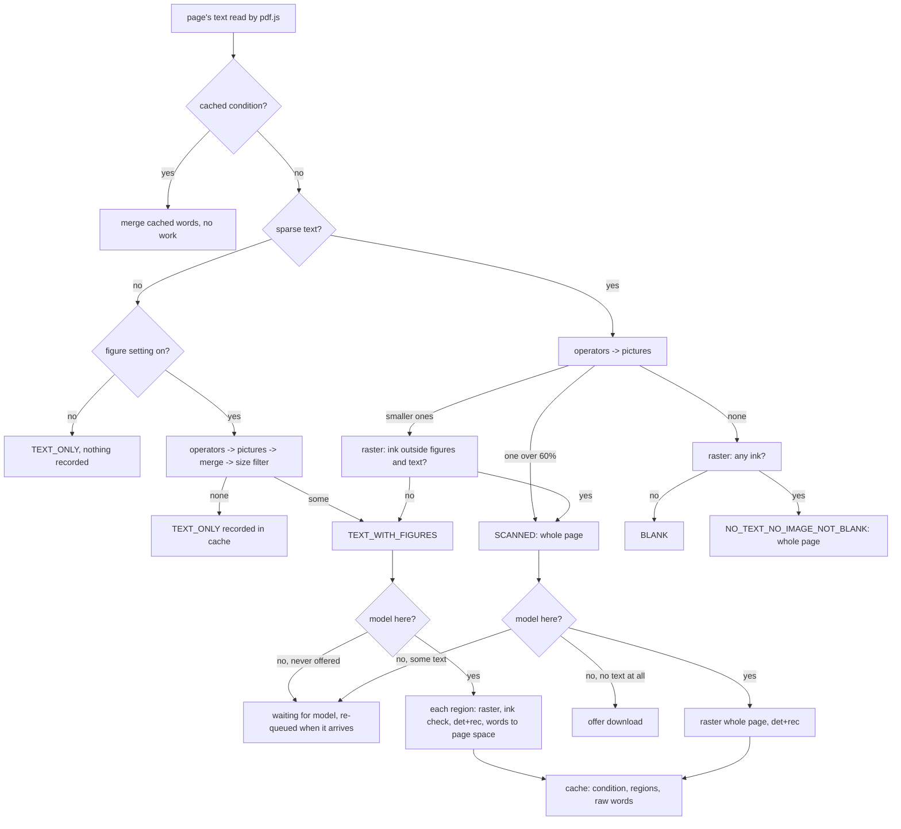

# On-device OCR for PDF pages

FineNotes reads text that exists only as pixels in a PDF, on the device, for
search, the highlighter that snaps to text, and Copy text. This document is for
contributors and for users who want to know exactly what it does.

## What it does, and what it does not

- Reads **scanned pages** (a picture of text), **pages with no text at all** that
  have ink (text drawn as outlines), and **the pictures on pages that have text
  of their own** (the labels in an anatomy figure, a chart, a photographed
  form). The last is "image-area OCR".
- Never reads text that is already in the page's text layer. Native text always
  wins: an OCR word that lies over it is dropped.
- **On demand, never the whole vault.** Only PDFs that an open notebook shows
  are looked at: the page in view first, then its neighbours, then the rest of
  that PDF only while idle. A PDF no open notebook uses is dropped from the
  queue. One page (one picture area) at a time; nothing starts while the pen
  writes.
- Nothing downloads without a yes. The model (35.7 MB) is offered only for a page
  with no text of its own and some ink.
- Printed text only. Messy handwriting is left alone (see the filter below).
- Does not: read vertical or rotated text (lines leaning more than about 15
  degrees are dropped), read CJK reliably (the dictionary has it, but it is
  untested), tell double letters reliably, or read pages in the background of
  PDFs nobody has open. No run on a real iPad yet (see Known limits).

Settings (Pages and notebooks): **Read scanned PDF pages (on-device OCR)**
(`ocrScannedPdfs`, default on) and, under it, **Also read text inside figures**
(`ocrFigureText`, default on, only in effect while the first is on). Both take effect without reopening a notebook: turned on, the pages shown are
looked at now (and those waiting for the model join its queue); turned off, figure words already in the
cache are hidden from layout and search at read time, not deleted, and what was queued for them is left.
The command **Re-read scanned pages of this PDF** forgets that PDF's cache and reads it again.

## Page conditions

Every page of a PDF that is looked at is exactly one of five conditions
(`src/recognition/ocr/figures.ts`, pure and unit-tested):

| condition                    | what the page is                                                                                | what is read                     |
| ---------------------------- | ----------------------------------------------------------------------------------------------- | -------------------------------- |
| `TEXT_ONLY`                  | text of its own, no picture worth reading                                                       | nothing: no raster, no model     |
| `TEXT_WITH_FIGURES`          | text of its own and at least one qualifying picture                                             | only the pictures' areas, padded |
| `SCANNED`                    | no or sparse text, one picture over at least 60% of the page (or other ink beside the pictures) | the whole page                   |
| `NO_TEXT_NO_IMAGE_NOT_BLANK` | no text, no qualifying picture, but ink                                                         | the whole page                   |
| `BLANK`                      | nothing on it                                                                                   | nothing                          |

How each is detected:

1. **Text.** The page's text items are laid out (`canvas/pdf-text.ts`). The page is
   _sparse_ when it has fewer than 40 characters or its characters cover less
   than 2% of its area (`isSparse`).
2. **Pictures, from the PDF itself.** pdf.js's operator list (`getOperatorList`,
   `OPS` from the same pdf.js `pdf-text-source.ts` uses) is turned into a short
   list of `save` / `restore` / `transform` / `image` operations (`gfxOpsFrom`;
   form XObjects become save + transform, repeated and grouped images one image
   per placement). `collectImages` follows the current transformation matrix,
   maps the unit square of every `paintImageXObject`, `paintInlineImageXObject`,
   `paintImageXObjectRepeat` and `paintImageMaskXObject` through it and the
   page's viewport (so rotation and an offset origin are right), boxes it
   (rotated and flipped images included), and clips it to the page. Its
   resolution is the stored pixels over the inches it covers. `mergeImages` joins
   boxes that overlap or lie within 3 pt (a picture cut into strips is one);
   `isFigureSized` drops those under 0.5 in on either side or under 1.5% of the
   page. The pdf.js call is a dozen lines (`view/pdf-figures.ts`).
3. **The decision** (`classifyPage`): text and no figure is `TEXT_ONLY`; text and a
   figure is `TEXT_WITH_FIGURES`; sparse with a figure covering at least 60% is
   `SCANNED`; sparse with smaller figures is `TEXT_WITH_FIGURES` _after_ a raster
   of the rest of the page shows no ink outside the figures and the page's own
   text (otherwise the whole page is read as `SCANNED`); sparse with no figure
   is `NO_TEXT_NO_IMAGE_NOT_BLANK` until a raster shows it has no ink at all,
   which makes it `BLANK` (`settledCondition`). When the pictures cannot be
   looked at (the figure setting is off, or the operator list failed) a dense
   page is left alone and a sparse one is read whole, as before, and nothing is
   recorded for it.

Clip paths other than the page edge are not tracked: a picture cropped by a clip
is taken whole, and the clipped part draws white, so it reads as nothing.

## The pipeline

(`src/recognition/ocr/`, pure; the networks are behind an `OcrBackend`.)

1. **Detection** (`det.ts`, `db.ts`). The image is cut into 800 px tiles with 96 px
   overlap, each run through PP-OCRv5 mobile **DBNet**; the probability maps are
   stitched. DB post-processing thresholds at 0.3, finds 8-connected blobs, fits a
   rectangle along each blob's own direction, scores it (mean probability at least
   0.6), grows it by the unclip distance (area x 1.5 / perimeter), and drops blobs
   that are tiny, unsure, or lean more than 0.26 rad. Boxes go into reading order.
2. **Recognition** (`rec.ts`, `ctc-words.ts`). Each box is cropped to 48 px high
   (`REC_CORE` 1.2: the box is taken to be 1.2x the text's height, so the crop is
   its height/1.2 and the font is not squashed), batched by width (4 per batch,
   widths within 1.35x), and run through the **SVTR** recogniser. **CTC** decoding
   gives characters with their positions and probabilities.
3. **Words** (`ctc-words.ts`, `word-edges.ts`). Characters are grouped into words at
   gaps; each word's box is extended by half the line's median character pitch
   beyond its first and last character (a tenth more on the right), then
   **snapped to the ink** of the crop: the widest ink-free gap between words. Mean
   word IoU against ground truth 0.82 to 0.89 on the noisy synthetic page.
   3b. **Second reading** (`REC_RETRY`). A line that has a word under the confidence filter, or no word, is
   read again with the box taken as 1.0 and as 1.4 times the text's height; the reading with the most
   trusted characters is kept.
4. Each word keeps its mean confidence and its least character confidence, and a
   line its mean. Words are boxed in the page's points (pixels / scale + the
   region's origin for a picture area).

### The handwriting confidence filter

Words are stored raw and filtered when read, so retuning needs no new reading
(`keptLines`, `OCR_TUNING`): a line is dropped whole when its mean confidence is
below **0.75**; a word is kept when the mean of its characters is at least
**0.85** and the least is at least **0.5**. On the synthetic page with scribbles
and cursive (7 regions) no scribble produced a kept word; the CER of what was kept
against the printed text was 0.36%.

## Mixed pages and the native-text merge

`mergedItems` returns the page's own items plus the kept OCR words that do not lie
over native text (`dropCovered`): an OCR word is dropped when 30% of it lies under
one native word, or under several together (a label read as one word across a line
of text), or when IoU with one native word reaches 30%. A page with sparse text
gets OCR words only while it is still sparse; a `TEXT_WITH_FIGURES` page always
gets its figure words (unless the figure setting is off); `TEXT_ONLY` and `BLANK`
pages never do. Figure captions sit beside the pictures, which is why the overlap
drop is applied to figure words too.

## Image-area OCR

For a `TEXT_WITH_FIGURES` page the service reads each padded region on its own,
one at a time:

- **Padding.** Each figure box is widened by 6 pt (labels sit at the edge of a
  picture), kept on the page, and boxes that now touch are merged again so nothing is
  read twice.
- **Resolution** (`regionRaster`): about the picture's own stored pixel density,
  between 170 and 300 dpi, and with no side longer than 2200 px. Small figure labels
  (3 to 6 pt) need it.
- **Raster.** The shared PDF worker draws the page at that scale with a transform
  that moves the region's corner to the canvas corner; if the worker cannot run, the
  main-thread pdf.js does the same (`view/ocr-raster.ts`).
- **Ink check.** A region with no ink beyond the page's own text is not sent to the
  model.
- **Read.** det + rec on the region; the worker is told the region's origin so the
  words come back in page space. Same queue, priority, pen hold, cancel and retry
  rules as a whole page; if the pen goes down or the PDF is closed between two
  regions, the page is put back and read again later.
- **Download rule.** A `TEXT_WITH_FIGURES` page is read only when the model is
  already on the device. If it is not, the page waits in the "waiting for model"
  list and joins the queue when the model arrives. It never makes the download be
  offered (only a page with no text at all may).

## Tunables

`OCR_TUNING` (`ocr-words.ts`) and the other constants. "Measured" refers to the
lecture documents below or the synthetic page.

| name                                                          | value                   | meaning, and why                                                                                                                                                    |
| ------------------------------------------------------------- | ----------------------- | ------------------------------------------------------------------------------------------------------------------------------------------------------------------- |
| `wordMean`                                                    | 0.85                    | a word's mean character confidence at least this; the scribble test kept none and the printed page lost none                                                        |
| `wordMin`                                                     | 0.5                     | the least character at least this                                                                                                                                   |
| `lineMean`                                                    | 0.75                    | a line below this is dropped whole                                                                                                                                  |
| `sparseAreaShare`                                             | 0.02                    | native text covering under 2% of the page is sparse                                                                                                                 |
| `sparseChars`                                                 | 40                      | fewer characters is sparse (a page number, a header)                                                                                                                |
| `overlap`                                                     | 0.3                     | share of an OCR word under native text that drops it                                                                                                                |
| `figureMinSide`                                               | 36 pt                   | a picture under 0.5 in on either side is an icon, logo, bullet or badge; the smallest figure with labels in the lecture PDFs is 116 pt                              |
| `figureMinAreaShare`                                          | 0.015                   | under 1.5% of the page is not a figure either                                                                                                                       |
| `figureMergeGap`                                              | 3 pt                    | pictures this close are one figure (strips)                                                                                                                         |
| `figurePad`                                                   | 6 pt                    | a label at the picture's edge is still read                                                                                                                         |
| `scannedShare`                                                | 0.6                     | a sparse page with a picture over 60% of it is a scan                                                                                                               |
| `figureMinDpi` / `figureMaxDpi`                               | 170 / 300               | raster resolution follows the picture, clamped; every figure in the lecture PDFs is stored above 300 dpi, so all were read at 300 dpi                               |
| `figureMaxEdge`                                               | 2200 px                 | longest side of a region raster (memory on a phone)                                                                                                                 |
| `OCR_DPI` / `OCR_MAX_EDGE`                                    | 170 / 2200              | whole-page raster                                                                                                                                                   |
| `DET_TILE_SIDE` / `DET_TILE_OVERLAP`                          | 800 / 96 px             | smaller tiles than 1280 cut peak memory by about 270 MB with the same accuracy                                                                                      |
| `DB_THRESHOLD`, `DB_BOX_SCORE`, `DB_UNCLIP_RATIO`, `MAX_TILT` | 0.3, 0.6, 1.5, 0.26 rad | PaddleOCR's own post-processing values; tilt is about 15 degrees                                                                                                    |
| `MIN_PIXELS`, `MIN_SIDE`, `MIN_GROWN_SIDE`, `MIN_ELONGATION`  | 12 px, 3 px, 6 px, 2    | box finder: a blob under 12 pixels, under 3 px thick, or under 6 px thick after growing is noise; a blob less than 2x longer than thick has no direction of its own |
| `MASK_PAD`                                                    | 2 px                    | native text rectangles are widened by this when masked out of an ink or edge check                                                                                  |
| `MAX_IMAGES`                                                  | 1000                    | images read from one page's operators; more is a pattern, not a figure                                                                                              |
| `REC_CORE`                                                    | 1.2                     | see the variant table                                                                                                                                               |
| `REC_STRIDE`, `REC_BATCH`                                     | 8, 4                    | pixels per CTC time step; recogniser batches of 4 for memory                                                                                                        |
| `RIGHT_BIAS`                                                  | 0.1                     | a tenth more on a word's right edge                                                                                                                                 |
| `CLASSIFY_VERSION`                                            | 1                       | bump when the classification rules change: a `TEXT_ONLY` page recorded under older rules is looked at again                                                         |
| `IDLE_MS`                                                     | 3000                    | pages away from the one in view wait until nothing happened for this long                                                                                           |
| `RETRY_MS`, `MAX_FAILURES`                                    | 60 s, 4                 | a failed page is not retried for a minute; four failures in a row and OCR rests for the session                                                                     |
| `SAVE_MS`                                                     | 2500                    | the cache is written this long after the last page                                                                                                                  |

**REC_CORE variants** (synthetic scan pages, Chromium, real models; CER of all words
on `a-scan`, `a-scan-1col`; double-letter words exact): 1.0: 0.50%, 0.78%, 18/21;
1.1: 0.00%, 0.09%, 21/21; **1.2: 0.14%, 0.44%, 21/21 (chosen)**; 1.3: 0.36%, 0.17%. A horizontal stretch of 1.15 or 1.3 gave no gain (0.07% to 0.61%). 1.2 is
the value with all double letters right and no cost on the clean page.

## Model files

Downloaded on first use into `<plugin>/ocr/ppocrv5/`, never bundled, each pinned by
exact size and SHA-256 (`ocr-model.ts`), over https from jsDelivr:

| file                             | bytes      | SHA-256                | source, licence                                                          |
| -------------------------------- | ---------- | ---------------------- | ------------------------------------------------------------------------ |
| `PP-OCRv5_mobile_det_infer.ort`  | 4,896,928  | `30acfc4e...420abc`    | PaddleOCR weights via npm `pdfmarkdown-ppocrv5-models@1.0.0`, Apache-2.0 |
| `PP-OCRv5_mobile_rec_infer.onnx` | 16,559,278 | `d253c3cb...9d22b3`    | same                                                                     |
| `ppocrv5_dict.txt`               | 74,014     | `9dfc80c5...166ff3`    | same                                                                     |
| `ort-wasm-simd-threaded.wasm`    | 14,239,897 | `3398c10d...78842dee2` | onnxruntime-web 1.30.0, MIT                                              |

Total 35.7 MB. The full hashes are in `src/recognition/ocr/ocr-model.ts` and
`THIRD_PARTY_NOTICES.txt` lists the licences. The OCR worker is started from a Blob
URL, one thread, handed the wasm bytes (no SharedArrayBuffer is needed).

## Cache

One JSON sidecar per PDF: `<plugin>/ocr/<SHA-256 of the PDF's bytes>.json`, so it
syncs with the vault and a PDF moved or renamed keeps it. **Format 2.** Per
zero-based page: the model version, `condition`, `regions` (the page-space rects
read, with their dpi), the page and image sizes, and the raw lines of words with
confidences. A `TEXT_ONLY` or `BLANK` page is recorded too, with no regions and no
words, so reopening a PDF costs nothing: no operators, no raster, no model. Entries
of format 1, of another model version, with an unknown condition, or a `TEXT_ONLY`
entry recorded under other `CLASSIFY_VERSION` rules are misses. The file is read
tolerantly (damaged pages and words are dropped), written a pause after the last
page and never while the pen is held, through a temporary name and then moved, and
merged with what another device may have added (a page read by this model is not
replaced by one read by another). Hashing the PDF reads its bytes once per file
version (cached by modification time and size).

## Scheduling

The queue (`ocr-queue.ts`): the PDF most recently looked at first; within it the
page in view, then pages at most 1 away (both whenever the pen is up), then the rest
nearest first only while idle. While idle, the pages of a PDF that has something to
read are probed (their text read, so they are classified) so the whole PDF is
classified without being drawn. The **pen hold** stops everything and nothing starts
until it has been up a moment. **Cancel:** closing the last notebook that shows a PDF
drops its queue and its worker copy. **Retry/backoff:** a failed page waits 60 s;
four failures in a row rest OCR until "Re-read" or a restart; one notice per session.
The OCR worker is released after 2 minutes idle.

## Measurements

Chromium (Playwright), real PP-OCRv5 models, one-thread wasm, Blob worker as on the iPad.

**Synthetic pages** (`ocr-e2e`, A4 at 170 dpi, 221 words; the same numbers before and after
the second reading and the background rule, so they did not regress): clean page CER 0.00%;
scan (1 degree rotation, noise, blur) 0.14%, mean word IoU 0.883; one-column scan 0.44%,
IoU 0.890; 21/21 double-letter words exact on the two-column pages (14/17 on the one-column
page); the scribbles-and-cursive page keeps 0 of 7 regions (CER of what was kept against the
printed text 0.36%); a merge test with a native "7" over the printed one keeps exactly one.
About 10 to 13 s per page (detect 3.3 s, recognise 7 to 10 s); the Blob worker gives a result
identical to the main thread.

**Memory.** Measured in the earlier rounds with the current settings (800 px tiles, recogniser
batches of 4, `REC_CORE` 1.2), one A4 page at 170 dpi, in the OCR worker:

| what                                                     | MB        | what it measures                                                                                                                                   |
| -------------------------------------------------------- | --------- | -------------------------------------------------------------------------------------------------------------------------------------------------- |
| wasm heap after the sessions are created                 | 65        | onnxruntime's linear memory holding both models                                                                                                    |
| wasm heap, peak after detection                          | 134       | models plus the detector's tensors for one 800 px tile                                                                                             |
| wasm heap, peak after recognition                        | 193       | models plus a batch of 4 recogniser crops                                                                                                          |
| total Chromium RSS, delta while the worker runs          | about 390 | every Chromium process (renderer, GPU, worker) over the idle baseline, so it includes the worker's JavaScript and canvases, not only the wasm heap |
| total Chromium RSS, delta after the worker is terminated | 109       | what stays after `terminate()`: allocator caches that Chromium has not returned                                                                    |

The wasm heap rows are what the model costs; the RSS rows are what a user's device sees. The
worker is released after 2 minutes idle (`IDLE_RELEASE_MS`). Figure regions are at most 2200 px
on a side, so a region read costs no more than a page read. An iPad has not been measured.

**Lecture PDFs.** The committed modules (`PdfTextCache`, `OcrService`, `OcrRasteriser`, figures,
pipeline) were run in Chromium over every page, with the real models and pdf.js 4.10 from npm
standing in for Obsidian's: each page was focused in turn, the service read it, and the tables
are read from the cache and a recomputation from the page. The harness is not committed. "Time"
is raster + OCR for that page.

**57.pdf** (8 pages, 612x866 pt)

| page | native chars | figures (page rects, pt) | skipped small | condition | regions read / rasters / OCR calls | words raw | dropped by confidence | dropped as covered | kept | time (ms) |
| ---- | ------------ | ------------------------ | ------------- | --------- | ---------------------------------- | --------- | --------------------- | ------------------ | ---- | --------- |
| 1    | 1315         | 0                        | 0             | TEXT_ONLY | 0 / 0 / 0                          | 0         | 0                     | 0                  | 0    | 0         |
| 2    | 951          | 0                        | 0             | TEXT_ONLY | 0 / 0 / 0                          | 0         | 0                     | 0                  | 0    | 0         |
| 3    | 1444         | 0                        | 0             | TEXT_ONLY | 0 / 0 / 0                          | 0         | 0                     | 0                  | 0    | 0         |
| 4    | 1642         | 0                        | 0             | TEXT_ONLY | 0 / 0 / 0                          | 0         | 0                     | 0                  | 0    | 0         |
| 5    | 1545         | 0                        | 0             | TEXT_ONLY | 0 / 0 / 0                          | 0         | 0                     | 0                  | 0    | 0         |
| 6    | 1830         | 0                        | 0             | TEXT_ONLY | 0 / 0 / 0                          | 0         | 0                     | 0                  | 0    | 0         |
| 7    | 1754         | 0                        | 0             | TEXT_ONLY | 0 / 0 / 0                          | 0         | 0                     | 0                  | 0    | 0         |
| 8    | 1423         | 0                        | 0             | TEXT_ONLY | 0 / 0 / 0                          | 0         | 0                     | 0                  | 0    | 0         |

OCR + raster time: 0.0 s; wall time for all pages (focus each in turn): 2.4 s

**53.pdf** (16 pages, 612x866 pt)

| page | native chars | figures (page rects, pt)                                                                                     | skipped small | condition         | regions read / rasters / OCR calls | words raw | dropped by confidence | dropped as covered | kept | time (ms) |
| ---- | ------------ | ------------------------------------------------------------------------------------------------------------ | ------------- | ----------------- | ---------------------------------- | --------- | --------------------- | ------------------ | ---- | --------- |
| 1    | 1326         | 0                                                                                                            | 0             | TEXT_ONLY         | 0 / 0 / 0                          | 0         | 0                     | 0                  | 0    | 0         |
| 2    | 913          | 1: [421,444,571,561]                                                                                         | 0             | TEXT_WITH_FIGURES | 1 / 1 / 1                          | 22        | 4                     | 0                  | 18   | 2127      |
| 3    | 778          | 2: [73,454,329,641] [346,454,539,641]                                                                        | 0             | TEXT_WITH_FIGURES | 2 / 2 / 2                          | 67        | 4                     | 0                  | 63   | 5844      |
| 4    | 1152         | 1: [427,392,549,515]                                                                                         | 0             | TEXT_WITH_FIGURES | 1 / 1 / 1                          | 28        | 1                     | 0                  | 27   | 1954      |
| 5    | 1418         | 0                                                                                                            | 0             | TEXT_ONLY         | 0 / 0 / 0                          | 0         | 0                     | 0                  | 0    | 0         |
| 6    | 1171         | 0                                                                                                            | 0             | TEXT_ONLY         | 0 / 0 / 0                          | 0         | 0                     | 0                  | 0    | 0         |
| 7    | 945          | 2: [176,562,313,696] [330,532,437,684]                                                                       | 0             | TEXT_WITH_FIGURES | 2 / 2 / 2                          | 149       | 12                    | 0                  | 137  | 7937      |
| 8    | 1415         | 0                                                                                                            | 0             | TEXT_ONLY         | 0 / 0 / 0                          | 0         | 0                     | 0                  | 0    | 0         |
| 9    | 1219         | 2: [186,487,287,574] [38,624,163,770]                                                                        | 0             | TEXT_WITH_FIGURES | 2 / 2 / 2                          | 12        | 5                     | 0                  | 7    | 1304      |
| 10   | 853          | 6: [60,410,268,526] [285,421,410,538] [427,421,552,538] [44,586,260,703] [277,575,394,691] [411,562,569,680] | 0             | TEXT_WITH_FIGURES | 6 / 6 / 6                          | 127       | 7                     | 0                  | 120  | 9099      |
| 11   | 1507         | 2: [59,532,370,637] [387,509,552,626]                                                                        | 0             | TEXT_WITH_FIGURES | 2 / 2 / 2                          | 56        | 25                    | 0                  | 31   | 4543      |
| 12   | 1788         | 1: [434,482,569,617]                                                                                         | 0             | TEXT_WITH_FIGURES | 1 / 1 / 1                          | 6         | 0                     | 0                  | 6    | 842       |
| 13   | 1951         | 0                                                                                                            | 0             | TEXT_ONLY         | 0 / 0 / 0                          | 0         | 0                     | 0                  | 0    | 0         |
| 14   | 1889         | 0                                                                                                            | 0             | TEXT_ONLY         | 0 / 0 / 0                          | 0         | 0                     | 0                  | 0    | 0         |
| 15   | 1716         | 0                                                                                                            | 0             | TEXT_ONLY         | 0 / 0 / 0                          | 0         | 0                     | 0                  | 0    | 0         |
| 16   | 634          | 0                                                                                                            | 0             | TEXT_ONLY         | 0 / 0 / 0                          | 0         | 0                     | 0                  | 0    | 0         |

OCR + raster time: 33.7 s; wall time for all pages (focus each in turn): 37.6 s

Findings:

- 57.pdf has no images: all 8 pages are `TEXT_ONLY`, with 0 rasters and 0 OCR calls (2.8 s in all,
  which is the text reads and the classification).
- 53.pdf: the 8 pages with images (2, 3, 4, 7, 9, 10, 11, 12) are `TEXT_WITH_FIGURES` and only their
  17 figure areas were drawn and read; the other 8 are `TEXT_ONLY`. No image-bearing page was left
  without a qualifying image: all 17 images are 116 pt or more on their short side and 1.5% or more
  of the page, and none was skipped as small (the "star n" badges are vector or text, not images).
  The page-10 operators place six images, all qualifying. No image covers 60% of any page.
- **No duplicates of native text.** Of 409 kept OCR words none overlaps a native word. Eight kept
  words equal a native word within 20 pt (a figure's own "Vesicovaginal Fistula", "Urinary
  Sphincter" and so on, above the native caption that repeats them): they are different pixels in
  a different place, 6 to 19 pt apart, not the native text read twice.
- **Search** now finds hits inside the figures (hits with the figure option off, then on): "Bladder"
  59 to 90 (31 inside figures), "sling" 5 to 10 (5), "urethra" 42 to 54 (12), "Pubic bone" 7 to 13
  (6). "Cooper" and "Burch" occur only in native text (1 and 2 hits both ways). The overlay
  `overlay-53-p10.png` (kept OCR boxes on page 10) shows each box on its label.

### Figure-label accuracy

Ground truth was transcribed by eye from 4x and 10x renders of all 17 figure areas: 171 labels (230
printed lines, 460 words). Matching is case-insensitive, ignores punctuation and ignores spaces (so
"250ml" matches "250 ml"). The headline is the full ground truth.

| measure                                                                   | round 1           | now                   |
| ------------------------------------------------------------------------- | ----------------- | --------------------- |
| **label recall** (found exactly)                                          | 131 / 171 = 76.6% | **134 / 171 = 78.4%** |
| printed lines found exactly                                               | 189 / 230 = 82.2% | 192 / 230 = 83.5%     |
| exact or near-miss (at most 40% character edits)                          | 147 / 171 = 86.0% | 149 / 171 = 87.1%     |
| CER over matched labels                                                   | 2.89%             | 1.80%                 |
| kept words that belong to a real label (misreads included)                | 390 / 400 = 97.5% | 397 / 409 = 97.1%     |
| kept words in an exactly-read label                                       | 343 / 400 = 85.8% | 354 / 409 = 86.6%     |
| kept words in no label                                                    | 10                | 12                    |
| secondary: recall excluding the 14 single panel letters (A. B. ... a b c) | 131 / 157 = 83.4% | 131 / 157 = 83.4%     |
| secondary: circled step numbers left out of the ground truth              | 137 / 171 = 80.1% | 141 / 171 = 82.5%     |
| secondary: strict word boundaries ("250ml" is a miss)                     | 122 / 171 = 71.3% | 125 / 171 = 73.1%     |

The target of 85% label recall is **not met** (78.4%; 83.4% without the single panel letters; 87.9%
without those and the circled step numbers, which are icons). Precision stayed above 95%.

**Where the missed labels were lost** (diagnosed before anything was changed, each figure read
alone, 39 misses of 171; instrumented box finder, annotated renders of the figures):

| where it was lost                                      | labels | which                                                                                                                                                                                                 |
| ------------------------------------------------------ | ------ | ----------------------------------------------------------------------------------------------------------------------------------------------------------------------------------------------------- |
| (i) no detector box at all                             | 9      | A. C. F. G. I. J. on the photograph (a box was found on a ring or a loop beside C, F and G, not on the letter), L4, panel letters b and c                                                             |
| (ii) a box was found but truncated                     | 2      | L2 and L3 (the box covers "2" and "3": the L is lost behind the nerve line)                                                                                                                           |
| (iii) read, then dropped by the confidence filter      | 12     | Delta < 30 and Delta > 30 (the symbol), Yes, E., K., Nil, Coughing, "(circle as appropriate)", and four lines that were read but lost words: the long instruction line, "of fluid", "day.", "(c)2023" |
| (iv) misread with high confidence                      | 6      | "Extemal" (twice), "Augumentation", "Visual Avt", "(c)Alila" and "5 Intestine and"                                                                                                                    |
| (v) dropped by the box finder's size or tilt rule      | 3      | S3 and S4 (two stacked labels form one 20 x 50 px blob, rejected as leaning), and the panel letter a (a 3 x 4 px blob under the 12 pixel minimum)                                                     |
| circled step number read as a symbol glued to the word | 6      | 1 Before surgery, 2 Bladder cut open, 3 Section of, 4 Intestine attached (twice), 6 Aftery surgery                                                                                                    |
| an icon read as a letter in front of the label         | 1      | "X Bladder Body/"                                                                                                                                                                                     |

Of 107 blobs the box finder rejected over the 17 figures, 100 were specks under 12 pixels (mostly
1 x 1), 4 leaned past the tilt limit and 3 scored under 0.6.

**What was tried**, each measured on the same 17 figures read alone (baseline 132 / 171 = 77.2%,
precision 98.5%); only changes that helped without costing precision were kept:

| change                                                        | recall                                  | real-label precision  | kept?                                                                  |
| ------------------------------------------------------------- | --------------------------------------- | --------------------- | ---------------------------------------------------------------------- |
| contrast stretch of the region (1st/99th percentile to 0/255) | 127 = 74.3%                             | 99.0%                 | no: the grey table cells were not what was lost, and it hurt elsewhere |
| box finder threshold 0.2 / 0.15 (from 0.3)                    | 133 = 77.8% / 132 = 77.2%               | 97.8% / 99.0%         | no: no real change                                                     |
| minimum blob size 6 px (from 12)                              | 132 = 77.2%                             | 98.3%                 | no: the only letter blob lost to it stays lost                         |
| region dpi up to 400 / 500 / 600 (from 300)                   | 136 = 79.5% / 126 = 73.7% / 129 = 75.4% | 99.5% / 98.2% / 97.7% | no: no trend, the spread is noise; the range stays 170 to 300          |
| confidence: word 0.8, min 0.5, line 0.75                      | 132                                     | 97.5%                 | no                                                                     |
| confidence: word 0.8, min 0.4, line 0.7                       | 132                                     | 97.8%                 | no                                                                     |
| confidence: word 0.75, min 0.4, line 0.65                     | 133                                     | 96.6%                 | no                                                                     |
| confidence: word 0.7, min 0.3, line 0.6                       | 135 = 78.9%                             | 95.8%                 | no: the cost is the 95% floor                                          |
| **second reading of unsure lines at `REC_CORE` 1.0 and 1.4**  | 134 = 78.4%                             | 98.1%                 | **yes**                                                                |

The second reading (`REC_RETRY`): a line with a word under the filter, or no word, is read again
with the box taken as 1.0 and as 1.4 times the text height, and the reading with the most trusted
characters is kept. It costs time only for unsure lines (53.pdf: 33 s to 38 s for the whole PDF).
It lifted the CER of matched labels from 2.89% to 1.80%. The synthetic page with scribbles still
keeps 0 of 7 regions, and no other synthetic number moved. The remaining misses are the box finder
and the recogniser's limit on glyphs a few pixels across, which a threshold does not fix.

### Pages with a picture behind the text

A slide background, a watermark or a paper texture is a picture over most of the page under text
the page already has. It must not make the page a whole-page read.

- `scanFigures` does not merge a picture covering 60% or more of the page (`scannedShare`) with the
  figures on it; `classifyPage` makes it a region flagged `backdrop`, kept whole, beside the padded
  figures. The figures are read first.
- Before det and rec, every region of a `TEXT_WITH_FIGURES` page is looked at for **content** outside
  the page's own text rectangles (and, for a backdrop, outside the figures on it): `hasEdgesOutside`
  counts pixels that differ from a neighbour by at least 40 luminance levels (`EDGE_STEP`) and wants 0.04%
  of the area (`EDGE_SHARE`), on a copy at most 640 px on a side. A plain, gradient or textured fill has
  no such edges, however dark (the older ink test would call a dark slide all ink). A region without
  content is not read and is recorded as read, with no words.
- If a backdrop does have content, it is read, and words inside a figure that was read on its own are
  dropped from it (they were read there at their own resolution).

Synthetic PDFs made with pdf-lib (a 612 x 792 pt page; the figure is a 400 x 300 px diagram with five
labels at 8 pt; the text is 46 lines of Helvetica over the picture), through the harness:

| PDF                                                        | native chars | regions          | rasters | OCR calls | read                                                              |
| ---------------------------------------------------------- | ------------ | ---------------- | ------- | --------- | ----------------------------------------------------------------- |
| light gradient background, dense text, one labelled figure | 2301         | figure, backdrop | 2       | 1         | "Aorta, Vena cava, Left kidney, Ureter, Bladder": only the figure |
| light gradient background, dense text                      | 2879         | backdrop         | 1       | 0         | nothing                                                           |
| dark navy gradient, white text, one labelled figure        | 2301         | figure, backdrop | 2       | 1         | the five labels, only the figure                                  |
| dark navy gradient, white text                             | 2879         | backdrop         | 1       | 0         | nothing                                                           |

## Known limits and TODOs

- No run on a real iPad yet. Speed and memory are measured in desktop Chromium; an
  iPad with wasm and no threads will be slower. A picture behind the text is skipped only
  if it has no content beyond the text (see the section above); a background that is itself a
  photograph with detail is read whole, once per page.
- Vertical and rotated text (more than 15 degrees) is dropped; CJK is untested.
- Double letters are right on the test pages but are the recogniser's weakest point,
  and so are single letters and symbols (circled digits, "Delta") on busy backgrounds.
- A circled step number is read as a symbol glued to the word, so a label that starts with one is not an exact match.
- Panel letters and single letters on photographs, and labels crossed by drawing lines, are the main
  remaining misses (see the diagnosis table); label recall on the lecture figures is 78.4%, below the
  85% aimed for.
- Clip paths other than the page edge are not tracked.
- Settings changes apply to the next time a page is read; a notebook already open
  keeps the text it has until the page is read again.
- Hashing a PDF to name its cache reads its bytes once; very large PDFs on a phone
  pay for that once per file version.
